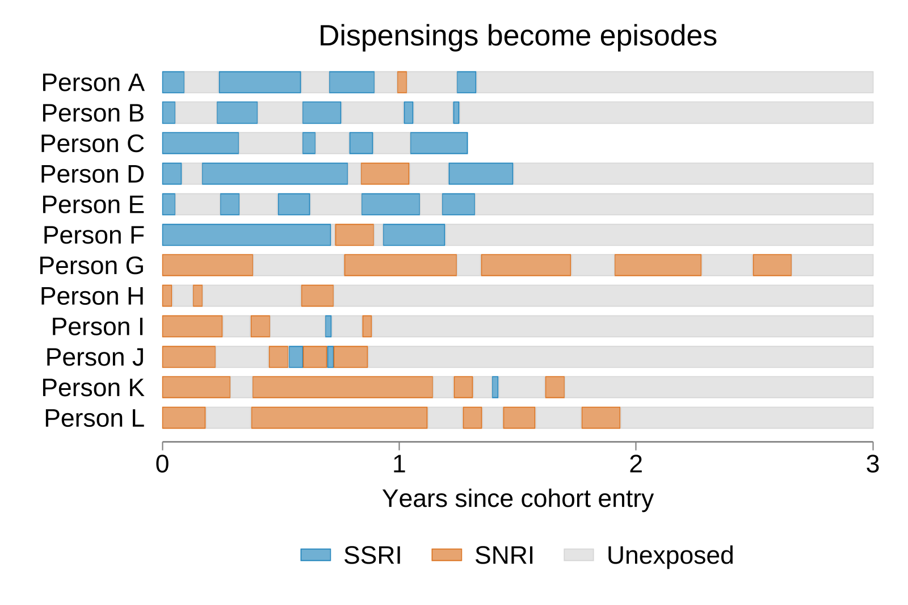
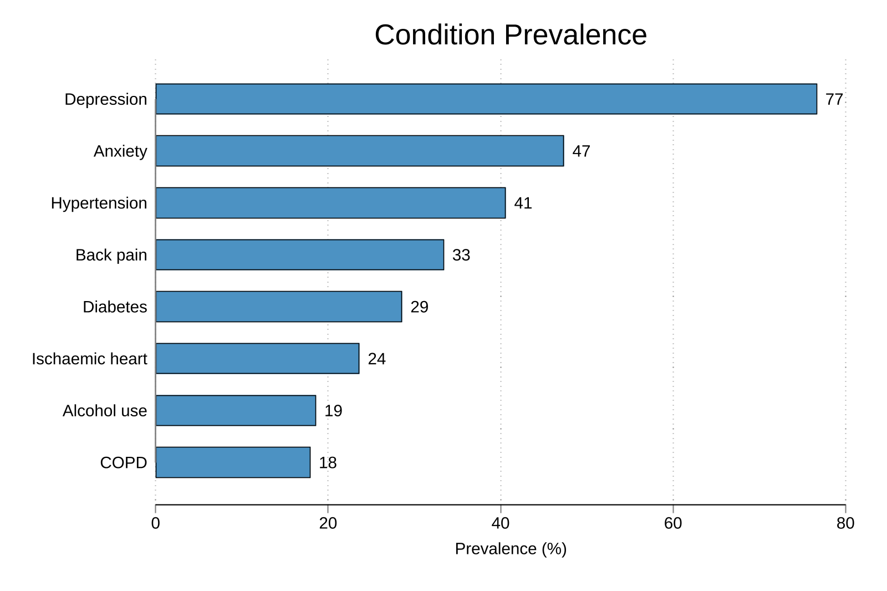
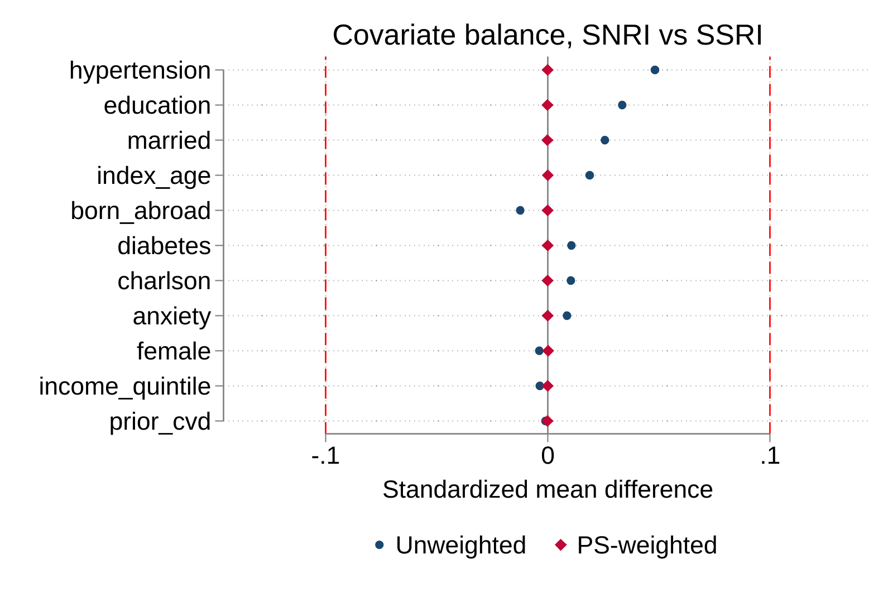
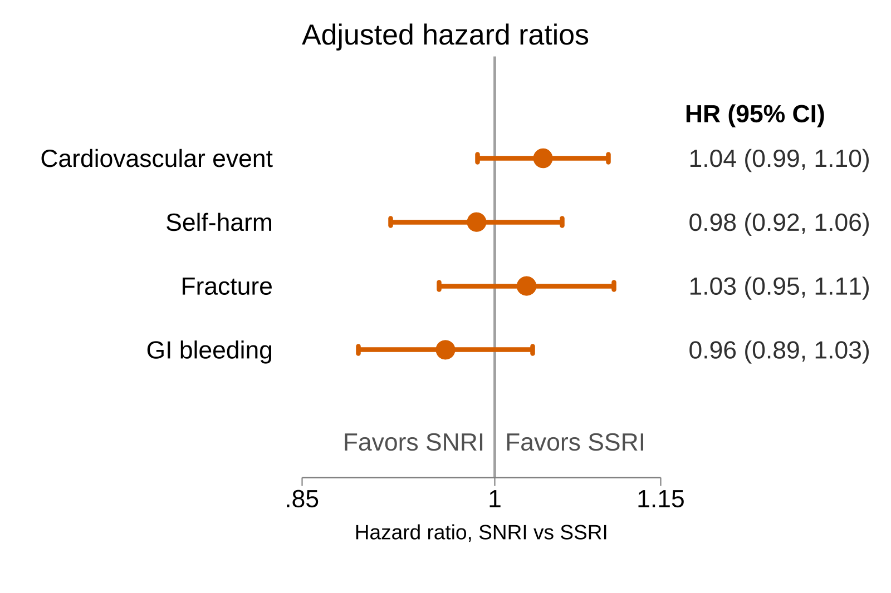
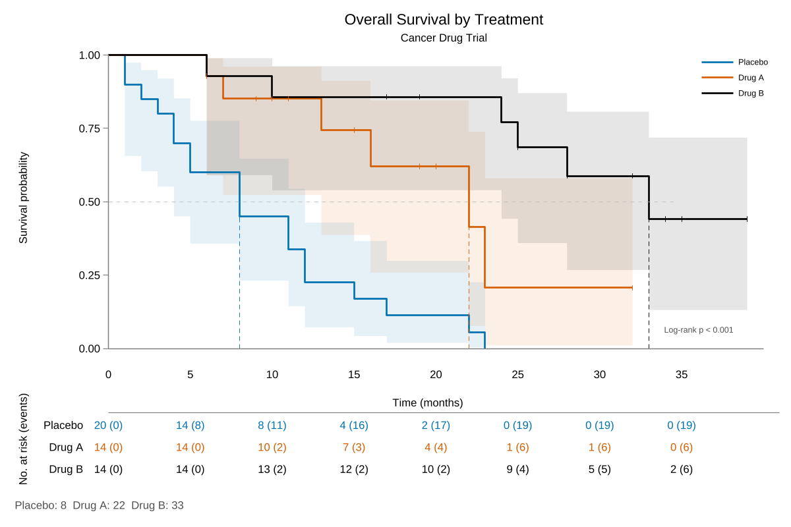
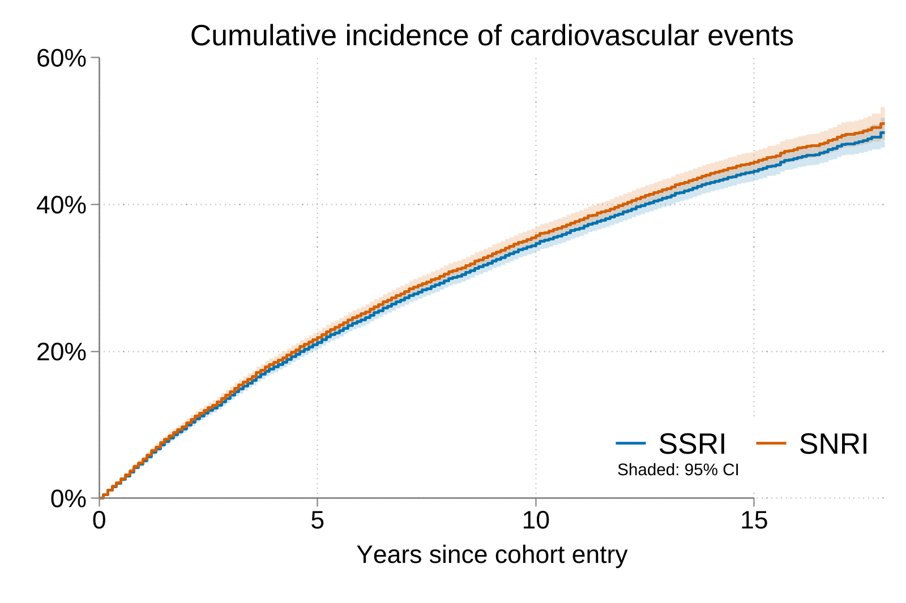
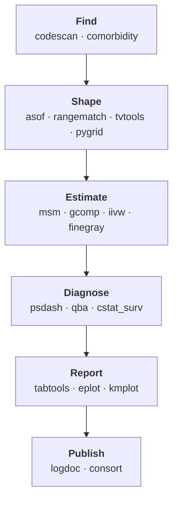
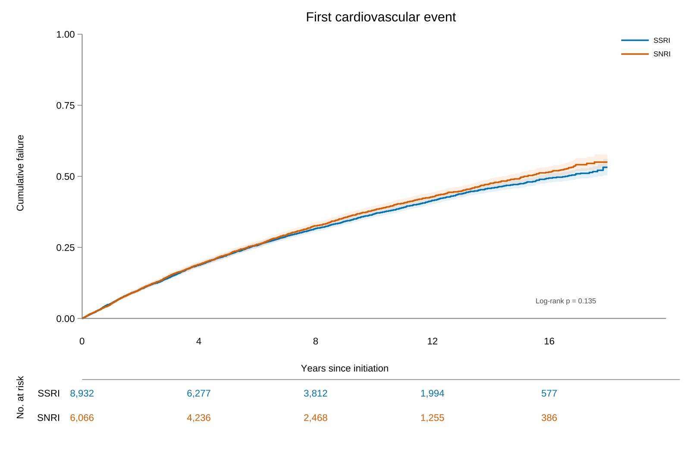

<p align="center"></p>

<p align="center"><b>Modern epidemiology, in Stata.</b><br>
Cohort building, time-varying exposures, causal inference, and survival analysis with publication-ready tables and figures, checked against R and Python.</p>

<p align="center">
  
  <a href="LICENSE"></a>
  
  <a href="https://github.com/tpcopeland/Stata-Tools/issues"></a>
</p>

<p align="center">
  <a href="#quickstart"><b>Quickstart</b></a> ·
  <a href="#install"><b>Install</b></a> ·
  <a href="#packages"><b>Packages</b></a> ·
  <a href="_data"><b>Example data</b></a> ·
  <a href="https://github.com/tpcopeland/Stata-Tools/issues"><b>Report a bug</b></a>
</p>

<table>
  <tr>
    <td width="33%" align="center"><a href="tvtools"></a><br><sub><b>tvtools</b> · dispensings → exposure episodes</sub></td>
    <td width="33%" align="center"><a href="codescan"></a><br><sub><b>codescan</b> · codes → conditions</sub></td>
    <td width="33%" align="center"><a href="psdash"></a><br><sub><b>psdash</b> · balance diagnostics</sub></td>
  </tr>
  <tr>
    <td width="33%" align="center"><a href="eplot"></a><br><sub><b>eplot</b> · forest plots from models</sub></td>
    <td width="33%" align="center"><a href="kmplot"></a><br><sub><b>kmplot</b> · KM curves with risk tables</sub></td>
    <td width="33%" align="center"><a href="finegray"></a><br><sub><b>finegray</b> · competing risks</sub></td>
  </tr>
</table>

<p align="center"><sub>Each figure is the package's own graphic. All but the kmplot panel (Stata's <code>cancer.dta</code>) use the synthetic SSRI vs SNRI cohort in <a href="_data"><code>_data/</code></a>; the scripts are in <a href="_resources/gallery"><code>_resources/gallery/</code></a>.</sub></p>

## Why Stata-Tools

- **Registry-scale data preparation.** Scan wide ICD, ATC, and procedure fields by regex or prefix within time windows, join measurements "as of" an anchor date, match records to intervals, and build time-varying exposure episodes.
- **Causal inference, end to end.** Marginal structural models with IPTW, parametric g-computation, inverse-intensity weighting for irregular visits, Fine-Gray competing risks, and quantitative bias analysis, each with its own diagnostics.
- **Checked, not just tested.** 17 packages ship cross-validation suites, and 14 of them compare results against reference implementations in R (`survival`, `cmprsk`, and others) or Python (`statsmodels`, `scikit-survival`, `pandas`).
- **Manuscript-ready output.** Table 1, regression, treatment-effect, and survival tables go straight to Excel or Markdown, with small-cell suppression when a registry requires it. Forest plots, KM curves with risk tables, and balance plots follow from the same estimates.
- **Try it on realistic data first.** 19 fully synthetic datasets that simulate a Swedish-registry antidepressant cohort load straight from GitHub. No real patients.
- **Plain Stata.** `net install` and `help <package>`; no compiled plugins. Only `consort` and `logdoc` call Python.

## How the pieces fit



<a id="quickstart"></a>
## Quickstart: a cohort to Table 1 and a KM curve

Install three packages, then run this on the synthetic SSRI vs SNRI cohort, loaded straight from GitHub:

```stata
foreach p in tabtools kmplot tc_schemes {
    capture ado uninstall `p'
    net install `p', from("https://raw.githubusercontent.com/tpcopeland/Stata-Tools/main/`p'") replace
}

local data "https://raw.githubusercontent.com/tpcopeland/Stata-Tools/main/_data"
use "`data'/cohort.dta", clear
merge 1:1 id using "`data'/treatment.dta", nogenerate
merge 1:1 id using "`data'/outcomes.dta", nogenerate keepusing(cv_event_date)

* Table 1 with standardized mean differences, to Excel and Markdown
table1_tc index_age female education income_quintile born_abroad, ///
    by(treated) smd xlsx("table1.xlsx") markdown("table1.md")

* Time to first cardiovascular event
generate cv   = !missing(cv_event_date) & cv_event_date <= study_exit
generate exit = cond(cv, cv_event_date, study_exit)
stset exit, failure(cv) origin(study_entry) scale(365.25)

set scheme white_tableau
kmplot, by(treated) failure ci risktable pvalue ///
    title("First cardiovascular event") xtitle("Years since initiation")
```

`table1.md`, exactly as `table1_tc` wrote it:

| No. (Column %) or Mean±SD | SSRI (N=8,934) | SNRI (N=6,066) | p-value | SMD |
| --- | --- | --- | --- | --- |
| Age at cohort entry (years) | 58±13 | 59±13 | 0.24 | 0.019 |
| Female sex | 5,351 (60) | 3,621 (60) | 0.80 | 0.004 |
| Education level |  |  | 0.11 | 0.035 |
| &nbsp;&nbsp;&nbsp;Primary | 2,333 (26) | 1,527 (25) |  |  |
| &nbsp;&nbsp;&nbsp;Secondary | 3,530 (40) | 2,354 (39) |  |  |
| &nbsp;&nbsp;&nbsp;Tertiary | 3,071 (34) | 2,185 (36) |  |  |
| Disposable income quintile |  |  | 0.73 | 0.024 |
| &nbsp;&nbsp;&nbsp;1 | 1,778 (20) | 1,175 (19) |  |  |
| &nbsp;&nbsp;&nbsp;2 | 1,783 (20) | 1,249 (21) |  |  |
| &nbsp;&nbsp;&nbsp;3 | 1,769 (20) | 1,228 (20) |  |  |
| &nbsp;&nbsp;&nbsp;4 | 1,786 (20) | 1,209 (20) |  |  |
| &nbsp;&nbsp;&nbsp;5 | 1,818 (20) | 1,205 (20) |  |  |
| Born outside Sweden | 1,362 (15) | 897 (15) | 0.44 | 0.013 |

And the plot:

<p align="center"></p>

Each package folder has a README with worked examples, and `help <package>` has the full reference.

<a id="install"></a>
## Install

```stata
capture ado uninstall tvtools
net install tvtools, from("https://raw.githubusercontent.com/tpcopeland/Stata-Tools/main/tvtools") replace
help tvtools
```

Swap `tvtools` for any package below. Run the same lines again to update, or `ado update, update` to update everything installed this way.

> [!IMPORTANT]
> Keep the `ado uninstall` line. If an older copy came from SSC or elsewhere, `net install` registers a second copy beside it instead of replacing it, and Stata may keep running the old one.

<a id="packages"></a>
## Packages

### Data preparation

| Package | What it does | Version |
| --- | --- | --- |
| [asof](asof) | Attach one measurement per ID and anchor date ("as-of" join), with explicit direction, selection, tie, and window rules |  |
| [codescan](codescan) | Flag, count, and summarize diagnosis, procedure, and drug codes across wide code fields, by regex or prefix, within time windows |  |
| [compress_tc](compress_tc) | Shrink string-heavy datasets: strL conversion, then `compress` |  |
| [datamap](datamap) | Document data without exposing it: privacy-safe maps and Markdown dictionaries (`datamap`, `datadict`), QC gates (`dataprobe`), a QA ledger (`dataqa`), missing-value patterns (`datamvp`) |  |
| [datefix](datefix) | Convert imported date strings to Stata dates, detecting day/month order and reporting values that fail |  |
| [fvgen](fvgen) | Turn factor-variable interactions into labeled main-effect and product variables for clean regression export |  |
| [massdesas](massdesas) | Convert every `.sas7bdat` in a directory tree to `.dta` |  |
| [pkgtransfer](pkgtransfer) | Move your installed packages to another machine, by online reinstall or offline ZIP |  |
| [rangematch](rangematch) | Range join: match records whose key falls in, or whose interval overlaps, each master interval (file or frame) |  |

### Cohorts, registries, and time-varying data

| Package | What it does | Version |
| --- | --- | --- |
| [comorbidity](comorbidity) | Charlson, Elixhauser, or custom scores from wide ICD-10 fields, with hierarchy rules and component indicators |  |
| [pygrid](pygrid) | Person-period denominator grids with zero-filled event attachment (`pygrid`, `pyattach`) |  |
| [setools](setools) | Swedish registry tools: Swedish Charlson index, ICD-7 to ICD-10 (`cci_se`), migration exclusions and censoring (`migrations`), MS progression endpoints (`sustainedss`, `cdp`, `pira`) |  |
| [tvtools](tvtools) | Time-varying exposure datasets for survival analysis: exposure episodes (`tvexpose`), merges (`tvmerge`), events (`tvevent`), IPTW/IPCW weights (`tvweight`), age bands, and diagnostics |  |

### Causal inference and survival

| Package | What it does | Version |
| --- | --- | --- |
| [cstat_surv](cstat_surv) | Harrell's C after `stcox`, with a leave-one-out jackknife SE and CI |  |
| [finegray](finegray) | Fast Fine-Gray competing-risks regression, with prediction, cumulative incidence, and a proportional subdistribution hazards diagnostic |  |
| [gcomp](gcomp) | Parametric g-computation for time-varying confounding and mediation; `gcomptab` tabulates the results |  |
| [iivw](iivw) | Inverse-intensity (IIW), IPTW, and combined FIPTIW weighting for irregularly timed visits, with diagnostics for informative visit processes |  |
| [msm](msm) | Marginal structural models with IPTW for time-varying treatment: prepare, weight, longitudinal balance and positivity, weighted fit, standardized risks; tables, plots and E-values via tabtools, psdash, eplot and qba |  |
| [psdash](psdash) | Propensity score diagnostics: overlap, balance (SMD, Love plot), weight distribution, common support; after `teffects`, `logit`/`probit`, `msm`, and more |  |
| [qba](qba) | Quantitative bias analysis for misclassification, selection bias, and unmeasured confounding: simple or probabilistic, chainable, plotted |  |

### Tables and reporting

| Package | What it does | Version |
| --- | --- | --- |
| [consort](consort) | CONSORT-style exclusion flowcharts, recorded as you drop observations |  |
| [diagtab](diagtab) | Diagnostic accuracy with CIs, ROC AUC, and cutoff analysis; console, Excel, CSV, Markdown, or frame output |  |
| [logdoc](logdoc) | Turn `.smcl`, `.log`, or `.do` files into HTML, Markdown, Quarto, Word, LaTeX, or PDF |  |
| [simtab](simtab) | Monte Carlo simulation performance metrics with MCSEs, as publication-ready tables |  |
| [tabtools](tabtools) | Manuscript tables to Excel and Markdown: Table 1 (`table1_tc`), regression (`regtab`), treatment effects (`effecttab`), survival (`survtab`), and more |  |

### Graphics

| Package | What it does | Version |
| --- | --- | --- |
| [eplot](eplot) | Forest and coefficient plots from variables, stored estimates, matrices, or frames |  |
| [kmplot](kmplot) | Kaplan-Meier and cumulative-failure curves with CIs, risk tables, landmarks, medians, and censor marks |  |
| [raincloud](raincloud) | Raincloud plots: density, raw points, and box summary in one figure |  |
| [spaghetti](spaghetti) | Individual trajectories over time, with optional group means and CIs |  |
| [swimlane](swimlane) | Swimmer and state swimlane plots for patient timelines |  |
| [tc_schemes](tc_schemes) | 45 graph schemes (blindschemes, schemepack, cleanplots, modern, and originals) behind one command |  |

<details>
<summary><b>Requirements beyond Stata 16</b></summary>

| Package | Needs |
| --- | --- |
| diagtab, simtab, tabtools | Stata 17+ |
| iivw | Stata 17+ for mixed-effects outcome models only |
| rangematch | Stata 16.1+ |
| massdesas | Stata 14+, plus `ssc install filelist` and `ssc install fs` |
| comorbidity | `codescan` from this repo |
| tabtools | `eplot` from this repo, for forest plots (optional) |
| consort | Python 3.7+ with matplotlib, to draw the diagram |
| logdoc | Python 3.6+ (standard library only); Stata 17+ for Word; `xhtml2pdf` or `wkhtmltopdf` for PDF |

</details>

## Example data

[`_data/`](_data) holds 19 fully synthetic datasets (no real patients) that simulate a Swedish-registry cohort of SSRI and SNRI antidepressant starters. Load any of them straight from GitHub:

```stata
use "https://raw.githubusercontent.com/tpcopeland/Stata-Tools/main/_data/cohort.dta", clear
```

<details>
<summary><b>What's in it</b></summary>

| File | Contents |
| --- | --- |
| `cohort.dta` | Cohort spine: one row per person, entry and exit dates, demographics |
| `treatment.dta` | Treatment group (SSRI or SNRI) |
| `outcomes.dta` | First cardiovascular, self-harm, fracture, and GI-bleeding event dates |
| `diagnoses.dta`, `procedures.dta`, `prescriptions.dta` | Long-format coded records with dates |
| `comorbidities.dta`, `cci.dta` | Comorbidity flags and Charlson scores at entry |
| `lisa.dta` | Socioeconomic register: education, income, employment |
| `migrations.dta`, `migrations_wide.dta` | Migration and residence history |
| `relapses.dta`, `relapses_only.dta` | Relapse and recurrence events |
| `calendar.dta` | Calendar-time covariates |
| `tv_antidep.dta`, `tv_antidep_episodes.dta`, `tv_benzo_episodes.dta`, `tv_events.dta`, `tv_merged.dta` | Time-varying exposure episodes and events for `tvtools` |

</details>

## Resources

[`_resources/`](_resources) holds the logos (the Stata-Tools hex and one per package), the scripts behind every figure on this page, and [`stata_docs.py`](_resources/stata-docs), a standalone tool that turns your own Stata PDF manuals into an offline, searchable library for you or a coding assistant.

## Contributing and support

Found a bug or want a feature? [Open an issue](https://github.com/tpcopeland/Stata-Tools/issues). Please include the package version (`which <command>`), your Stata version, and a minimal example, ideally on one of the `_data/` datasets.

---

<p align="center"><sub>Timothy P Copeland, Karolinska Institutet · <a href="LICENSE">MIT License</a></sub></p>
