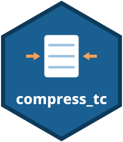

<p align="center"></p>

# compress_tc — Shrink string-heavy Stata datasets

**Version 1.2.0** | 2026-10-13

[](#version-history) [](#requirements) [](../LICENSE) [](../README.md)

**[Quick Start](#quick-start)** · **[Installation](#installation)** · **[Key Options](#key-options)** · **[Stored Results](#stored-results)** · **[Stata-Tools](../README.md)** · **[Report a bug](https://github.com/tpcopeland/Stata-Tools/issues)**

`compress_tc` reduces memory use in string-heavy Stata datasets by converting fixed-width strings to `strL` and then running Stata's built-in `compress`. It is for users who want a reportable way to apply or preview string-storage changes while retaining the resulting `r()` values.

## Quick Start

After [installing](#installation), run a two-stage compression and inspect the dataset-wide result:

```stata
sysuse auto, clear
compress_tc make, detail
display "Saved " r(bytes_saved) " bytes (" %4.1f r(pct_saved) "%)"
```

`make` is a fixed-width string variable in `auto`; `detail` prints its original storage type. The final summary and `r()` values report total data-memory changes, which can be positive or negative.

## Features

- **Two stages, one command.** Eligible `str#` variables are recast to `strL`, then `compress` moves any that are cheaper as `str#` back; `nostrl` or `nocompress` runs one stage alone.
- **Totals you can trust.** The summary uses Stata's dataset-wide `memory` totals and reports a negative saving when `strL` overhead outweighs the gain, rather than hiding it.
- **Preview before you commit.** `dryrun` restores the original data after a projected run and leaves the projected results in `r()`.
- **Large data in limited memory.** `lowmem` converts and compresses one variable at a time, and `minlength(#)` leaves short strings out of the `strL` stage.

## Requirements

- Stata 16 or later
- Datasets that keep `strL` variables must be saved in Stata 13+ `.dta` format (version 117 or later)

## Installation

Install the released package from Stata-Tools:

```stata
capture ado uninstall compress_tc
net install compress_tc, from("https://raw.githubusercontent.com/tpcopeland/Stata-Tools/main/compress_tc") replace
```

For a local Stata-Tools checkout, replace the URL with the package directory:

```stata
capture ado uninstall compress_tc
net install compress_tc, from("/path/to/Stata-Tools/compress_tc") replace
```

## Commands

| Command | Description |
|---------|-------------|
| `compress_tc` | Two-stage compression for selected string variables, with reporting and memory controls |

## Key Options

```stata
compress_tc [varlist] [, nocompress nostrl noreport quietly detail varsavings lowmem dryrun minlength(#)]
```

`varlist` is optional. The minimum option abbreviations accepted by the command are `noc`, `nos`, `nor`, `q`, `d`, `vars`, `low`, `dry`, and `min`. `minlength(#)` accepts a non-negative integer and defaults to `0`. Specifying both `nocompress` and `nostrl` exits with error 198 because it would disable both stages.

| Option | Default | Effect |
|--------|---------|--------|
| `nocompress` | off | Skip the final `compress` stage and keep only the `strL` conversion |
| `nostrl` | off | Skip `strL` conversion and run standard `compress` only |
| `noreport` | off | Suppress the per-variable output emitted by `compress` while retaining the summary |
| `quietly` | off | Suppress normal output while retaining stored results in `r()` |
| `detail` | off | When stage 1 runs, show each eligible fixed-width string variable's original storage type |
| `varsavings` | off | Show per-variable type transitions and before/after memory; default batch mode shows shared `strL` heap bytes as a dash |
| `lowmem` | off | Convert and, unless `nocompress` is specified, compress one eligible variable at a time |
| `dryrun` | off | Restore the original data after a projected run while retaining projected stored results |
| `minlength(#)` | `0` | Convert only `str#` variables at least `#` bytes wide; skipped variables still reach final `compress` when that stage runs |

When `lowmem` performs `strL` conversion, `varsavings` uses measured whole-dataset deltas for each variable and therefore includes its `strL` heap effect. The final `compress` stage is required for the peak-memory benefit, but not for this measurement. Without `lowmem`, a shared `strL` heap cannot be attributed to individual variables and is displayed as a dash.

## Stored Results

`compress_tc` is an r-class command and stores the following results.

### Scalars

| Result | Contents |
|--------|----------|
| `r(bytes_saved)` | Total data bytes saved, equal to `r(bytes_initial) - r(bytes_final)` and possibly negative |
| `r(pct_saved)` | Percentage reduction in total data size |
| `r(bytes_initial)` | Dataset-wide data bytes before the run |
| `r(bytes_final)` | Dataset-wide data bytes after the run, or after the projected run with `dryrun` |
| `r(bytes_strl)` | Bytes held in the `strL` heap after the run or projected run |
| `r(k_converted)` | Number of eligible fixed-width string variables recast to `strL` |
| `r(k_reverted)` | Number of those variables that the final `compress` stage moved back to a fixed-width type |

### Local macros

| Result | Contents |
|--------|----------|
| `r(vars_strl)` | Names of selected string variables stored as `strL` after the run |
| `r(varlist)` | Names in the command's processing scope: fixed-width strings by default, or all string variables with `nostrl` |

## QA

QA suites and how to run them are documented in [`qa/README.md`](qa/README.md).

## Version History

- **1.2.0** (2026-10-13): The report is now self-explanatory. When strL conversion precedes `compress`, a note says that `compress`'s own "bytes saved" is measured from the strL-converted data (under `lowmem`, from data already converted per variable) while `Overall` is measured against the original data. With `varsavings`, an `(other variables)` row accounts for numeric variables that `compress` retyped, so the table sums to `Overall` when no processed variable stays strL (strL variables show dashes). The strL-heap note prints only when a variable ends as strL. `dryrun` now projects exactly what a real run reports: it no longer counts a 24-byte strL residue left by `preserve`, which understated `r(bytes_saved)` by 24 and reported `r(bytes_strl)` = 24.
- **1.1.1** (2026-08-05): Corrected the `detail`, `lowmem`, per-variable savings, size-unit, and demo documentation.
- **1.1.0** (2026-06-19): `varsavings` now reports real per-variable before/after bytes and savings; added `lowmem` (incremental conversion that limits peak memory when the final `compress` stage runs), `dryrun` (preview without modifying data), and `minlength(#)` (skip strL for short strings). Sizes display in the most readable unit (B/KB/MB/GB). New stored results `r(bytes_strl)`, `r(k_converted)`, `r(k_reverted)`, `r(vars_strl)`.

<details><summary>Earlier versions</summary>

- **1.0.0** (2026-04-08): Initial Stata-Tools release of the two-stage string-compression workflow.

</details>

## Author

Timothy P Copeland, Karolinska Institutet

This package is a fork of `strcompress` by Luke Stein.

Questions and bug reports: [GitHub issues](https://github.com/tpcopeland/Stata-Tools/issues). Please include the first line of `which compress_tc` and your Stata version.

To cite: Copeland TP. *compress_tc: Shrink string-heavy Stata datasets*. Stata-Tools, https://github.com/tpcopeland/Stata-Tools/tree/main/compress_tc. Please give the version you used (`which compress_tc` prints it).

## License

MIT (see [LICENSE](../LICENSE))
