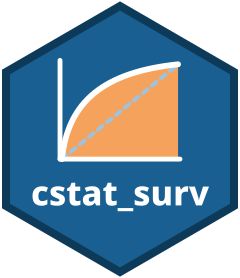

# cstat_surv — Harrell's C-statistic after `stcox`

**Version 1.0.3** | 2026-10-13

[](#version-history) [](#requirements) [](../LICENSE) [](../README.md)

**[Quick Start](#quick-start)** · **[Installation](#installation)** · **[Key Options](#key-options)** · **[Stored Results](#stored-results)** · **[Stata-Tools](../README.md)** · **[Report a bug](https://github.com/tpcopeland/Stata-Tools/issues)**

`cstat_surv` measures how well a Cox model discriminates: run it after `stcox` and it reports Harrell's C-statistic with a leave-one-out jackknife standard error, a confidence interval, and the pair counts behind it.

## Quick Start

After [installing](#installation), fit a Cox model on `stset` data and run the command immediately afterwards:

```stata
sysuse cancer, clear
stset studytime, failure(died)
stcox age
cstat_surv
```

For a 90% interval, type `cstat_surv, level(90)` in place of `cstat_surv`; it can be run right after the first call, without refitting. The command posts its own `e()` results and replaces the Cox estimates. Calling `cstat_surv` again right after itself (for example with a different `level()`) replays those results at the new level without recomputing; it returns r(301), leaving `e()` untouched, if the data changed since `cstat_surv` ran: a different dataset, or an in-place edit of `_t`, `_d`, `_t0`, `_st`, or a Cox covariate or strata variable within the estimation sample. Re-sorting, `preserve`/`restore`, and storage-type changes (`compress`) do not count as changes. Rerun `stcox` if you need the original model results in `e()` again, or to compute a C-statistic for a different model.

## Features

- **Harrell's C for the model you just fitted.** Hazard ratios are predicted from the active `stcox` results and every comparable pair in the estimation sample is compared; an event and a censoring at the same time are comparable, two events at the same time are not (Harrell, Lee and Mark 1996).
- **Inference included.** A leave-one-out jackknife standard error and a t-based confidence interval at `level()`, with Somers' D (`2C - 1`) and the concordant, discordant, and tied pair counts stored in `e()`.
- **Refuses what it cannot score.** Delayed entry in the Cox estimation sample and `stcox, tvc()` fits stop with `r(498)` before any prediction, leaving the Cox estimates in place; with weighted Cox fits it notes that the pairs are unweighted.
- **Posts like an estimator.** `e(b)`, `e(V)`, `e(vcetype)` (`Jackknife`), and `e(sample)` are set, so the C-statistic can be listed, stored, and reported like any other estimate.

## Requirements

- Stata 16 or later
- Survival-time data declared with `stset`
- Current Cox model results from `stcox`

## Installation

```stata
capture ado uninstall cstat_surv
net install cstat_surv, from("https://raw.githubusercontent.com/tpcopeland/Stata-Tools/main/cstat_surv") replace
```

## Commands

| Command | Description |
|---------|-------------|
| `cstat_surv` | Calculate Harrell's C-statistic after `stcox` |

## Key Options

| Option | Description |
|--------|-------------|
| `level(#)` | Set the confidence level, in percent, for confidence intervals; defaults to Stata's current `c(level)` (95 unless changed with `set level`) |

## Stored Results

`cstat_surv` stores the following results in `e()`:

| Result | Type | Description |
|--------|------|-------------|
| `e(c)` | Scalar | Harrell's C-statistic |
| `e(se)` | Scalar | Leave-one-out jackknife standard error |
| `e(ci_lo)` | Scalar | Lower confidence limit |
| `e(ci_hi)` | Scalar | Upper confidence limit |
| `e(df_r)` | Scalar | Degrees of freedom |
| `e(somers_d)` | Scalar | Somers' D statistic, equal to `2C - 1` |
| `e(N)` | Scalar | Number of observations |
| `e(N_comparable)` | Scalar | Number of comparable pairs |
| `e(N_concordant)` | Scalar | Number of concordant pairs, fractional with ties |
| `e(N_discordant)` | Scalar | Number of discordant pairs, fractional with ties |
| `e(N_tied)` | Scalar | Number of tied pairs |
| `e(level)` | Scalar | Confidence level |
| `e(cmd)` | Macro | `cstat_surv` |
| `e(depvar)` | Macro | `_t` |
| `e(title)` | Macro | `Harrell's C-statistic` |
| `e(vcetype)` | Macro | `Jackknife` |
| `e(sigvars)` | Macro | Variables covered by the data signature (`_t _d _t0 _st`, the Cox covariates, and strata) |
| `e(datasignature)` | Macro | `_datasignature` of those variables over the estimation sample, taken after sorting by all of them so row order does not matter; checked on a repeat call |
| `e(b)` | Matrix | Coefficient vector for the C-statistic |
| `e(V)` | Matrix | Variance-covariance matrix |
| `e(sample)` | Function | Estimation-sample indicator |

## Assumptions and Limits

- The data must be declared with `stset` before the Cox model is fit, and the current estimation results must come from `stcox`.
- The C-statistic uses unweighted pairs even when the original `stcox` model used weights; the command displays a note when weights are detected.
- Two events at the same survival time are not comparable; an event and a censoring at that same time are comparable.
- Time-varying coefficients from `stcox, tvc()` are refused with `r(498)`, including its default time function.
- Delayed entry is refused with `r(498)`: `_t0` must be zero in the Cox estimation sample. The refusal preserves the active Cox estimates; entry times outside `e(sample)` do not trigger it.
- Multi-record counting-process data are not supported; the command assumes one record per subject.
- The algorithm compares all pairs of observations and has O(n²) complexity. For datasets with more than 10,000 observations, computation may take several seconds.
- The command exits with an error when no comparable pairs are found.

## References

- Harrell FE Jr, Lee KL, Mark DB. Multivariable prognostic models: issues in developing models, evaluating assumptions and adequacy, and measuring and reducing errors. *Statistics in Medicine*. 1996;15(4):361–387. [doi:10.1002/(SICI)1097-0258(19960229)15:4<361::AID-SIM168>3.0.CO;2-4](https://doi.org/10.1002/%28SICI%291097-0258%2819960229%2915%3A4%3C361%3A%3AAID-SIM168%3E3.0.CO%3B2-4)

## QA

QA suites and how to run them are documented in [`qa/README.md`](qa/README.md).

## Version History

- **1.0.3** (2026-10-13): A second `cstat_surv` call after the first (for example with another `level()`) no longer fails with r(301); the repeat call replays the posted results at the new `level()` after checking a `_datasignature` of the data (taken in a fully sorted order, so row order does not matter) (in-place edits to `_t`, `_d`, `_t0`, `_st`, or a covariate return r(301); `e(sigvars)` and `e(datasignature)` are new; nothing is stored in the estimates list, and a restored older `cstat_surv` result is never recomputed against another model).
- **1.0.2** (2026-09-30): Refuse delayed entry in the Cox estimation sample and time-varying coefficients from `tvc()` before predictions or pair calculations, preserving the active estimates.
- **1.0.1** (2026-08-05): Correct the documented default confidence level and clarify the valid estimation sample used for pair comparisons.
- **1.0.0** (2026-07-10): Initial Stata-Tools release

## Author

Timothy P Copeland, Karolinska Institutet

Questions and bug reports: [GitHub issues](https://github.com/tpcopeland/Stata-Tools/issues). Please include the first line of `which cstat_surv` and your Stata version.

To cite: Copeland TP. *cstat_surv: Harrell's C-statistic after `stcox`*. Stata-Tools, https://github.com/tpcopeland/Stata-Tools/tree/main/cstat_surv. Please give the version you used (`which cstat_surv` prints it).

## License

MIT (see [LICENSE](../LICENSE))
