<p align="center"></p>

# kmplot — Kaplan-Meier and competing-risks curves with risk tables

**Version 1.0.0** | 2026-10-26

[](#version-history) [](#requirements) [](../LICENSE) [](../README.md)

**[Quick Start](#quick-start)** · **[Installation](#installation)** · **[Options](#options)** · **[Gallery](#gallery)** · **[Stata-Tools](../README.md)** · **[Report a bug](https://github.com/tpcopeland/Stata-Tools/issues)**

`kmplot` draws Kaplan-Meier survival or cumulative failure curves, or Aalen-Johansen cumulative incidence curves with a competing event, from `stset` data, with confidence bands, a number-at-risk table, medians, and a log-rank p-value in one command. It returns the risk table, landmark estimates, and plot metadata in `r()`, and can save the curve data for reuse.

## Quick Start

After [installing](#installation), draw a publication-style figure from Stata's own cancer trial data (the `label define` line names the two active drugs, which `cancer.dta` labels "Other" and "NA"):

```stata
sysuse cancer, clear
label define type 2 "Drug A" 3 "Drug B", modify
stset studytime, failure(died)
kmplot, by(drug) ci median medianannotate pvalue censor risktable riskevents timepoints(0 5 10 15 20 25 30 35)
```

<p align="center">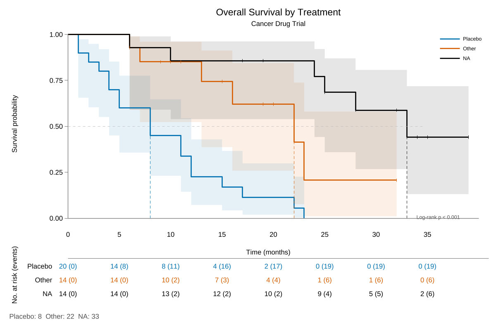</p>

<sub>Drawn by `demo/demo_kmplot.do`, which also sets the `white_tableau` scheme and adds `title()`, `subtitle()`, and `xtitle("Time (months)")`.</sub>

## Features

- **Competing risks.** `compete(exp)` draws the Aalen-Johansen cumulative incidence, weighted by the `stset` weight; without weights its standard errors and ln(-ln) bounds match `stcompet`.
- **Risk tables that line up.** The number-at-risk table shares the plot's time axis, and its counts honour delayed entry and multiple-record data. Under probability weights it counts people by default (`riskweight()`), and `riskmask()` prints small counts as `<5`.
- **Colour-blind-safe by default.** Curves use the Okabe-Ito palette, chosen to stay distinguishable under simulated red-green colour-vision deficiency for up to five groups; `colors()` takes Stata colour names or quoted RGB triplets.
- **The numbers behind the picture.** `median`, `landmark()`, and `pvalue` add median lines, fixed-time estimates, and the log-rank p-value, and store them in `r(medians)`, `r(landmarks)`, and `r(p)`.
- **Follows `sts` conventions.** Greenwood standard errors with log-log (default), log, or plain intervals; bounds are missing where the estimate is exactly 1 or 0, as in `sts list`.
- **Reusable output.** `saving()` and `risksaving()` write the curve and risk-table datasets; `export()` writes the graph to PDF, PNG, EPS, or SVG.

## Requirements

- Stata 16 or later
- Data declared with `stset`
- No external packages

## Installation

```stata
capture ado uninstall kmplot
net install kmplot, from("https://raw.githubusercontent.com/tpcopeland/Stata-Tools/main/kmplot") replace
```

## Commands

| Command | Description |
|---------|-------------|
| `kmplot` | Draw Kaplan-Meier survival or cumulative failure curves with publication-oriented defaults |

## How It Works

`kmplot` reads the current `stset` definition and plots a step-function Kaplan-Meier estimate for the analysis sample; no separate model-fitting command is required.

- The default graph is survival, `S(t)`. Add `failure` to plot cumulative failure, `1 - S(t)`.
- Add `by(varname)` for one curve per group; numeric and string grouping variables are supported, and value labels are used when available (unlabelled numeric levels show as `varname=value` in the variable's display format).
- Add `ci` for confidence intervals. The default is a shaded log-log interval; `cistyle(line)` draws dashed interval lines, and `citransform(log)` or `citransform(plain)` changes the transformation.
- Add `risktable` for a number-at-risk table, `landmark()` for fixed-time estimates, `median` for median reference lines, and `censor` for censoring marks. Risk tables place the time axis above a separating rule, use larger default text, count subjects in multiple-record data, and honor active `stset` weights.
- Add `compete(exp)` to plot the cumulative incidence of the `stset` failure with the records where `exp` is true as a competing event (Aalen-Johansen; a competing event leaves the risk set instead of being censored).
- `percent`, `ymax()`, `tmax()`, and `byorder()` set a percent axis, the axis limit, the plotted horizon, and the group order; failure and incidence plots get an automatic y range that fits the curves.
- Add `pvalue` with `by()` when at least two groups are present to display the Stata log-rank p-value; invalid p-value requests exit with return code 198.
- `saving()` and `risksaving()` write reusable curve and risk-table datasets, while `export()` writes the graph through Stata's `graph export`.
- Standard `twoway` graph options are passed through after the named `kmplot` options.

## Choosing a Workflow

| Goal | Starting point |
|------|----------------|
| One overall survival curve | `kmplot` |
| Curves by treatment or another group | `kmplot, by(group)` |
| Manuscript-style comparison | `kmplot, by(group) ci risktable median pvalue censor` |
| Cumulative failure display | Add `failure` to the stratified workflow |
| Competing event (e.g. death) present | `kmplot, by(group) compete(cause == 2) risktable` after `stset ..., failure(cause == 1)` |
| Weighted cohort figure for a journal | Add `riskmask(5) percent tmax(#)`; counts stay unweighted under pweights |
| Fixed-time reporting or reproducible data export | Add `landmark()`, `saving()`, or `risksaving()` |

## Worked Examples

### 1. Basic Kaplan-Meier curve

The default is a single survival curve with step-function rendering.

```stata
sysuse cancer, clear
stset studytime, failure(died)
kmplot
```

### 2. Stratified publication-style figure

This combines confidence bands, a risk table, median reference lines, censoring marks, and a log-rank p-value for the treatment groups.

```stata
sysuse cancer, clear
stset studytime, failure(died)
kmplot, by(drug) ci risktable median medianannotate pvalue censor
```

### 3. Cumulative failure with selected risk-table times

Use `failure` for `1 - S(t)` and specify the risk-table columns explicitly with `timepoints()`.

```stata
sysuse cancer, clear
stset studytime, failure(died)
kmplot, by(drug) failure risktable timepoints(0 5 10 15 20 25 30 35)
```

### 4. Fixed-time estimates and saved datasets

`landmark()` returns estimates at the requested analysis times; the two saving options create datasets that can be reused in a table or downstream figure.

```stata
sysuse cancer, clear
stset studytime, failure(died)
kmplot, by(drug) ci risktable landmark(12 24) saving(km_curve.dta, replace) risksaving(km_risk.dta, replace)
matrix list r(landmarks)
matrix list r(risktable)
```

### 5. Custom confidence intervals, styling, and export

The graph can use line confidence intervals, a different transform, custom colors and patterns, a repositioned p-value, and a directly exported PDF.

```stata
sysuse cancer, clear
stset studytime, failure(died)
kmplot, by(drug) ci cistyle(line) citransform(log) colors(navy maroon dkorange) lpattern(solid dash dot) pvalue pvaluepos(bottomleft) export(km_figure.pdf, replace)
```

## Gallery

Run `demo/demo_kmplot.do` from a repository checkout to regenerate the PNGs below from `sysuse cancer` and, for the registry-scale panel and the landmark output, from the synthetic cohort in the repository's `_data/`; the two competing-risk panels use self-harm as the event, death as the competing event, and stabilized inverse-probability-of-treatment weights. The images are repository documentation assets and are not part of the `net install` payload.

| Output | Command focus |
|--------|---------------|
| 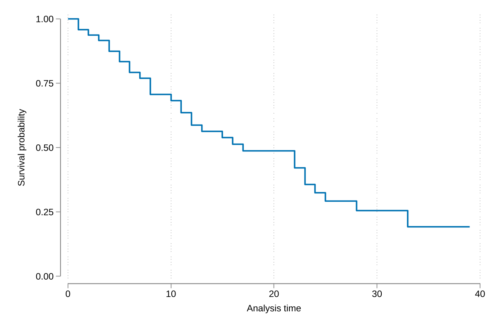 | Basic `kmplot` workflow |
| 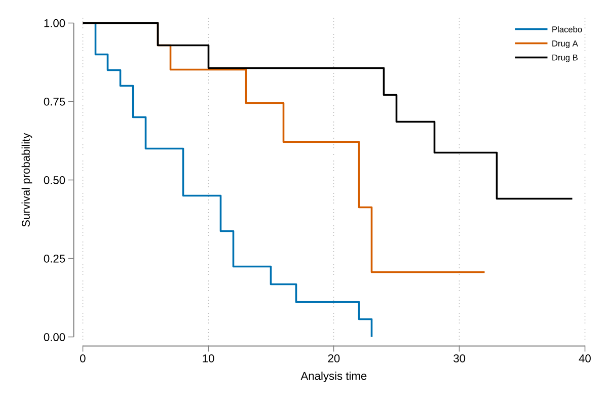 | `by()` |
| 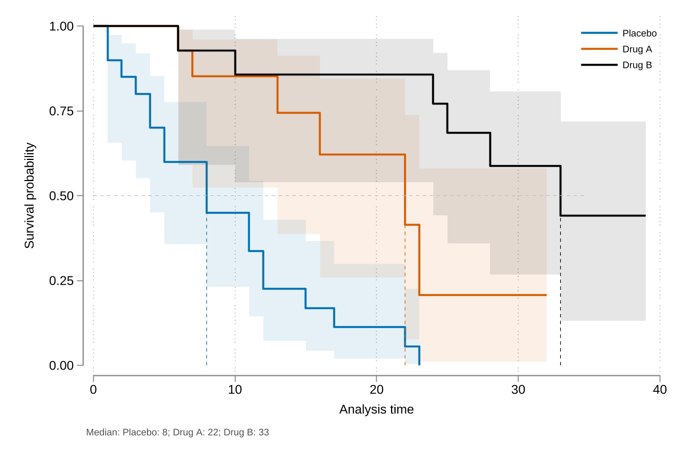 | `ci`, `median`, and `medianannotate` |
| 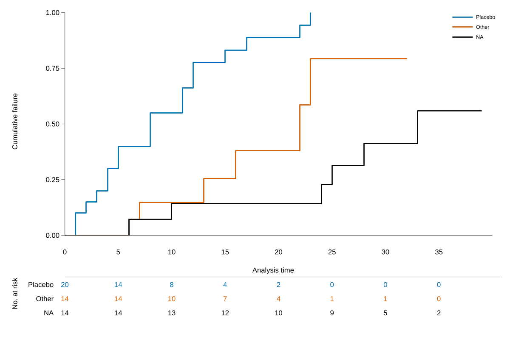 | `failure`, `risktable`, and `timepoints()` |
| 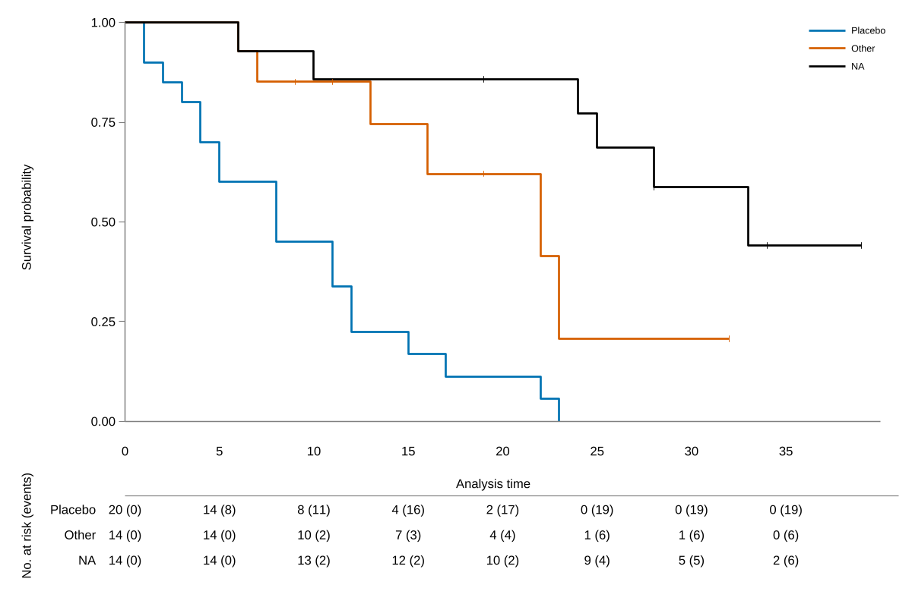 | `riskevents`, `riskmono`, and `censor` |
|  | Combined manuscript workflow |
| 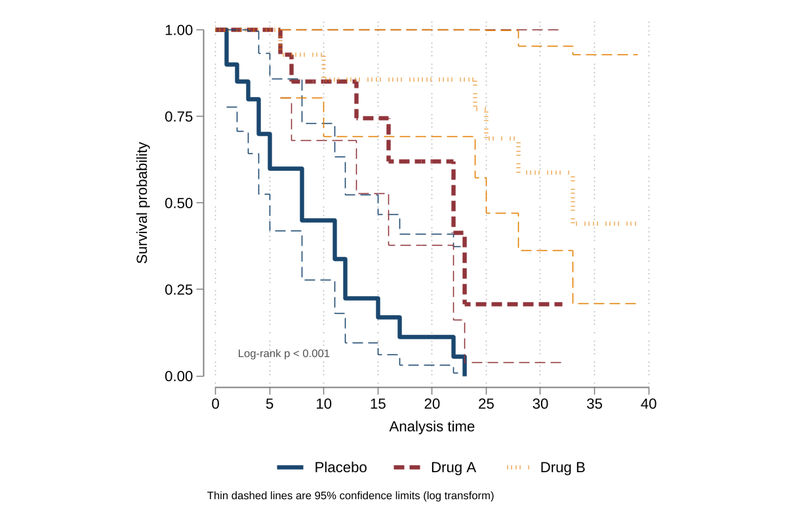 | `cistyle(line)`, `colors()`, `lpattern()`, and `pvaluepos()` |
| 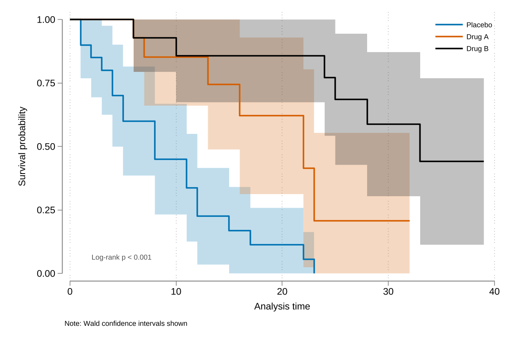 | `citransform(plain)`, `ciopacity()`, and `note()` |
| 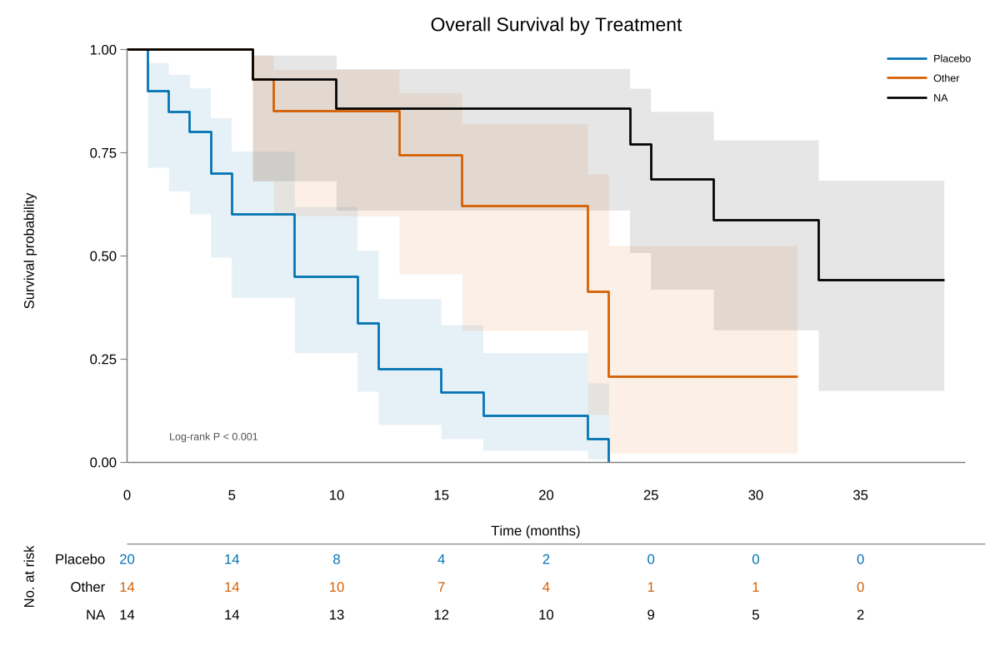 | `level(90)`, `pvaluetext()`, and `pvalueformat()` |
| 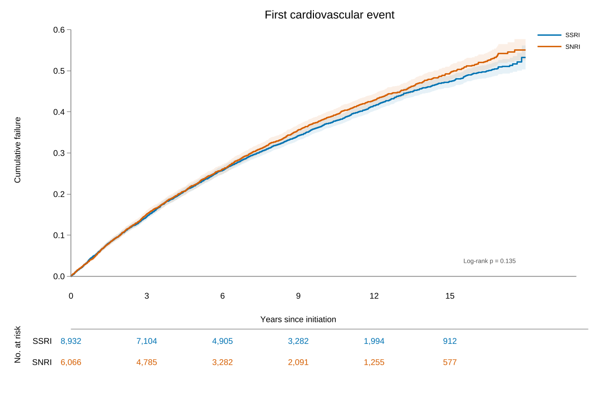 | Registry-scale `failure` with `risktable`; p-value in its default position |
| 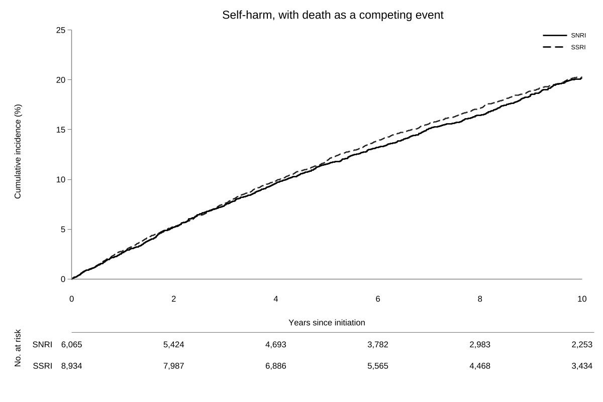 | `compete()` under pweights with `percent`, `tmax()`, `byorder()`, and people counts in the risk table |
| 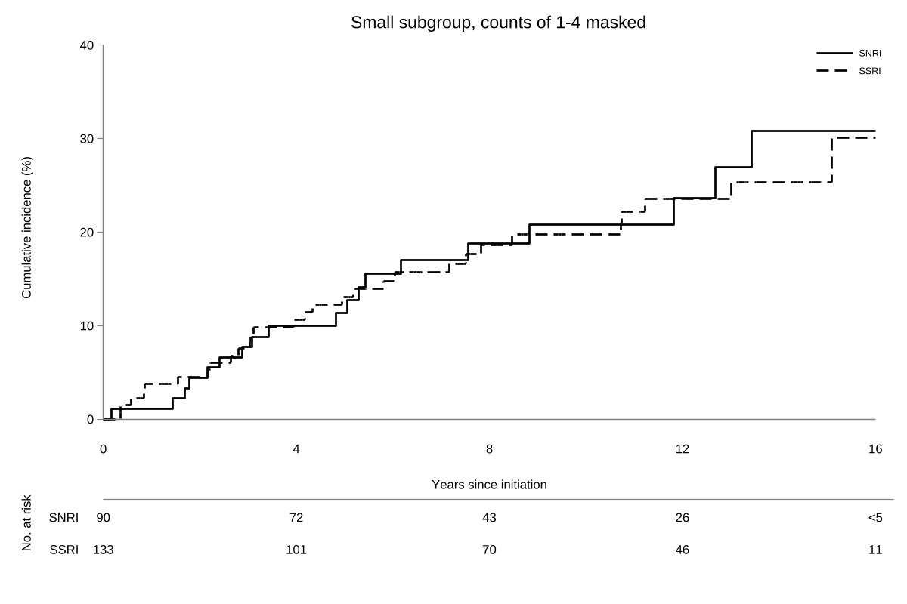 | `riskmask(5)` small-count masking |

### Landmark output from the demo

`landmark()` returns the estimate at fixed analysis times in `r(landmarks)`, with bounds when `ci` is specified. Rows are indexed by group in the order of `r(group_labels)`. From the same synthetic cohort:

```stata
kmplot, by(treated) failure ci landmark(1 5 10)
matrix list r(landmarks), format(%7.4f)
```

```
Groups: SSRI | SNRI

r(landmarks)[6,5]
       group      time  estimate     lower     upper
r1    1.0000    1.0000    0.0536    0.0491    0.0585
r2    1.0000    5.0000    0.2243    0.2154    0.2335
r3    1.0000   10.0000    0.3678    0.3564    0.3795
r4    2.0000    1.0000    0.0517    0.0463    0.0576
r5    2.0000    5.0000    0.2258    0.2150    0.2370
r6    2.0000   10.0000    0.3816    0.3675    0.3961
```

### Competing-risk output from the demo

With `compete()`, `landmark()` returns the Aalen-Johansen cumulative incidence and `r(estimator)` names the estimator. The weighted run has no bounds because `ci` is refused under pweights. On the same weighted cohort, 1 - Kaplan-Meier, which treats deaths as censored, gives a higher 10-year risk:

```stata
kmplot, by(treated) byorder(1 0) compete(status == 2) landmark(1 5 10) nodraw
matrix list r(landmarks), format(%7.4f)
kmplot, by(treated) byorder(1 0) failure landmark(10) nodraw
matrix list r(landmarks), format(%7.4f)
```

```
Estimator: aalen_johansen   Groups: SNRI | SSRI

r(landmarks)[6,5]
       group      time  estimate     lower     upper
r1    1.0000    1.0000    0.0265         .         .
r2    1.0000    5.0000    0.1153         .         .
r3    1.0000   10.0000    0.2018         .         .
r4    2.0000    1.0000    0.0282         .         .
r5    2.0000    5.0000    0.1188         .         .
r6    2.0000   10.0000    0.2030         .         .

Estimator: km_failure

r(landmarks)[2,5]
       group      time  estimate     lower     upper
r1    1.0000   10.0000    0.2154         .         .
r2    2.0000   10.0000    0.2164         .         .
```

### 6. Competing risks with a weighted cohort

Cumulative incidence of pelvic recurrence with distant recurrence as the competing event in Stata's cervical-cancer hypoxia data, weighted by illustrative stabilized inverse-probability weights for pelvic-node status. The plot is on a percent axis stopped at 8 years, the risk table counts women (counts of 1-4 masked), and the figure is black and white under the `sj` scheme.

```stata
webuse hypoxia, clear
logit pelnode age hgb tumsize
predict double ps, pr
summarize pelnode, meanonly
generate double sw = cond(pelnode, r(mean) / ps, (1 - r(mean)) / (1 - ps))
stset dftime [pw=sw], failure(failtype == 1)
kmplot, by(pelnode) byorder(1 0) compete(failtype == 2) risktable riskmask(5) percent tmax(8) timepoints(0(2)8) colors(black black) lpattern(solid dash) landmark(5) scheme(sj) graphregion(color(white))
matrix list r(landmarks)
```

## Options

| Option | Default | Effect |
|--------|---------|--------|
| `by(varname)` | none | Stratify curves by a numeric or string variable |
| `failure` | survival | Plot cumulative failure, `1 - S(t)`, instead of survival |
| `compete(exp)` | none | Plot the Aalen-Johansen cumulative incidence of the `stset` failure with `exp` (a single expression) marking the competing event; implies `failure`; not with `pvalue` or `median`; `ci` without weights or with fweights only; a note is shown when `exp` is true on no record |
| `byorder(numlist)` | sort order | Order of numeric `by()` levels for drawing, legend, colors, patterns, and risk-table rows |
| `ci` | off | Draw confidence intervals |
| `level(#)` | `c(level)` (95 unless changed by `set level`) | Set the confidence level for `ci`; values must lie between 10 and 99.99 with at most two decimal places |
| `cistyle(string)` | `band` | Use shaded bands or dashed `line` intervals; requires `ci` |
| `ciopacity(#)` | 12 | Set shaded-band opacity from 0 to 100; requires `ci` with band intervals |
| `citransform(string)` | `loglog` | Use `loglog`, `log`, or `plain` confidence intervals; requires `ci` |
| `median` | off | Draw median reference lines for groups whose median is reached |
| `medianannotate` | off | Add median values to the graph note; requires `median` |
| `medianformat(%fmt)` | `%9.0g` | Numeric (`%f`, `%g`, `%e`) display format for medians in the graph note and console summary; requires `median` |
| `risktable` | off | Add a separated number-at-risk table below the graph, with the time axis above it |
| `riskevents` | off | Add cumulative events as `N (events)` in the risk table; requires `risktable` |
| `riskcompact` | off | Synonym for `riskevents`; requires `risktable` |
| `riskmono` | off | Display risk-table numbers in black instead of line colors; requires `risktable` |
| `riskheight(#)` | auto | Set risk-table height; requires `risktable`; supplied values must be greater than 0 and no more than 80 |
| `timepoints(numlist)` | auto | Set risk-table timepoints, sorted with repeats dropped (`0(0.1)1` equals the typed decimals); none may exceed `tmax()`; requires `risktable` or `risksaving()` |
| `riskweight(none\|stset)` | `none` (pweight, iweight), `stset` (fweight) | Count people or sum the `stset` weight in the risk table; requires `risktable` or `risksaving()` |
| `riskmask(# [, text(string)])` | off, or `tabtools set smallcells` | Print counts from 1 to #-1 as `<#`; masked cells are missing in `r(risktable)` and `risksaving()` |
| `noriskmask` | off | Ignore the `tabtools` session small-cell default |
| `landmark(numlist)` | none | Return survival or cumulative-failure estimates at fixed nonnegative analysis times, sorted with repeats dropped |
| `censor` | off | Show censoring marks on the curves |
| `censorthin(#)` | 1 | Show every Nth censor mark; requires `censor` and a value of at least 1 |
| `pvalue` | off | Display the log-rank p-value; requires `by()` |
| `pvaluepos(string)` | `bottomright` | Place the p-value at `bottomright`, `topright`, `topleft`, or `bottomleft`, anchored 5% inside the drawn y range |
| `pvalueformat(string)` | `%5.3f` | Set the numeric (`%f`, `%g`, `%e`) display format for the p-value; p-values below 0.001 are shown as `< 0.001` whatever the format |
| `pvaluetext(string)` | `Log-rank p` | Set the text printed before the p-value |
| `pvalueat(y x)` | none | Place the p-value at explicit graph coordinates; may not be combined with `pvaluepos()` |
| `colors(colorlist)` | Okabe-Ito palette | Set curve colors as Stata color names or quoted RGB triplets; the default is blue, vermilion, black, sky blue, reddish purple, orange, and bluish green, which stay distinguishable under simulated red-green color-vision deficiency for up to five groups |
| `lwidth(string)` | `medthick` | Set curve line width |
| `lpattern(patternlist)` | `solid` | Set curve line patterns |
| `title(string)` | none | Set the graph title; this and the four options below take `text [, textbox options]`, with several quoted strings for several lines and a `size()` that replaces the default |
| `subtitle(string)` | none | Set the graph subtitle |
| `xtitle(string)` | `Analysis time` | Set the x-axis title; `xtitle("")` draws none, also with `risktable` |
| `ytitle(string)` | mode-dependent | Set the y-axis title; the default is `Survival probability`, `Cumulative failure`, or `Cumulative incidence` (with ` (%)` under `percent`) |
| `xlabel(string)` | automatic | Set x-axis labels; their numeric positions (labelled lists such as `0 "Start" 12 24` included) set risk-table columns when `timepoints()` is omitted, and with `risktable` an `xlabel()` without numeric positions (`#5`, `minmax`, `none`) then needs `timepoints()` |
| `ylabel(string)` | automatic | Set y-axis labels; survival uses `0(0.25)1`, failure and incidence plots run from 0 to just above the plotted maximum; text labels are supported |
| `ymax(#)` | automatic | Upper y-axis limit on the plotted scale; refused (rc 198) below the plotted maximum |
| `percent` | off | Plot 100 × the estimate; `r()` and saved data stay in proportions |
| `tmax(#)` | last time | Stop curves, x axis, and default risk-table timepoints at `#`; estimates unchanged; risk-table times beyond `#` are refused and median lines beyond it are not drawn |
| `legend(string)` | automatic | Supply a custom legend specification |
| `note(string)` | none | Add a graph note; if `medianannotate` is also requested, the user note replaces the automatic median annotation |
| `scheme(string)` | current Stata scheme | Set the graph scheme |
| `name(name[, replace])` | `kmplot` | Set the graph name (a single valid name); a graph of that name is always replaced |
| `aspectratio(string)` | none | Set the graph aspect ratio |
| `export(string)` | none | Export to a file; the format is inferred from `.pdf`, `.png`, `.eps`, or `.svg`, and graph-export suboptions are passed through |
| `saving(filename[, replace])` | none | Save curve data with `group`, `group_label`, `time`, `estimate`, `se`, `lower`, `upper`, `censor`, and `anchor` variables: one row per analysis record (tied times repeat) plus one time-zero anchor per group; `lower` and `upper` need `ci`; `se`, `lower`, and `upper` are missing where the survival estimate is 1 or 0 |
| `risksaving(filename[, replace])` | none | Save risk-table data with `group`, `group_label`, `time`, `at_risk`, `events`, and cumulative censoring exits in `censored` (on the `riskweight()` basis), their summed-weight companions `at_risk_w`, `events_w`, `censored_w`, and with masking the flags `at_risk_masked`, `events_masked`, `censored_masked` |
| `combineopts(string)` | none | Options for the `graph combine` that joins plot and risk table; requires `risktable` |

`kmplot` also accepts standard `twoway` graph options through its trailing pass-through syntax. With `risktable`, `graphregion()`, `plotregion()`, `xsize()`, and `ysize()` also reach the combined graph.

## Stored Results

`kmplot` is an `rclass` command and stores the following results after it computes a plot. If a requested graph or dataset write fails after plotting, analytical results remain available even though the command returns an error; `r(export)` records an attempted export path, while `r(saving)` and `r(risksaving)` are stored only after successful dataset saves.

### Scalars

| Result | Meaning |
|--------|---------|
| `r(N)` | Number of observations in the analysis sample |
| `r(n_groups)` | Number of plotted groups |
| `r(level)` | Confidence level that applies to `ci` (stored even when `ci` is not requested) |
| `r(failure)` | 1 if `failure` was requested, otherwise 0 |
| `r(ci)` | 1 if `ci` was requested, otherwise 0 |
| `r(n_landmarks)` | Number of requested landmark timepoints |
| `r(n_timepoints)` | Number of risk-table timepoints, or 0 when neither `risktable` nor `risksaving()` was used |
| `r(riskheight)` | Risk-table height when `risktable` is specified |
| `r(p)` | Log-rank p-value when `pvalue` was used with `by()` and at least two groups were present |
| `r(pvalue_y)` | Y coordinate of the drawn p-value text when the log-rank p-value was computed |
| `r(pvalue_x)` | X coordinate of the drawn p-value text when the log-rank p-value was computed |
| `r(median_#)` | Median for group `#` (`r(median_1)`, `r(median_2)`, ...), stored with `median` for groups whose median is reached |
| `r(ymax)` | Upper y-axis limit on the plotted scale |
| `r(tmax)` | `tmax()` when specified |
| `r(riskmask)` | Masking threshold when masking is on |

### Macros

| Result | Meaning |
|--------|---------|
| `r(cmd)` | `kmplot` |
| `r(graph_name)` | Graph name |
| `r(plot_type)` | `survival` or `failure` (also `failure` with `compete()`) |
| `r(estimator)` | `km`, `km_failure`, or `aalen_johansen` |
| `r(compete)` | The `compete()` expression when specified |
| `r(scale)` | `proportion` or `percent` |
| `r(riskweight)` | `none` or `stset` when a risk table or `risksaving()` was produced |
| `r(scheme)` | Graph scheme used |
| `r(by)` | Grouping-variable name when `by()` was specified |
| `r(cistyle)` | CI style used |
| `r(citransform)` | CI transformation used |
| `r(colors)` | Color list used |
| `r(lpattern)` | Line-pattern list supplied, if any |
| `r(timepoints)` | Risk-table timepoints used |
| `r(landmark_times)` | Landmark timepoints requested |
| `r(group_labels)` | Group labels joined by a vertical bar |
| `r(xtitle)` | X-axis title |
| `r(ytitle)` | Y-axis title |
| `r(export)` | Requested export path when `export()` was specified, including after a failed file write |
| `r(saving)` | Curve dataset path when `saving()` succeeded |
| `r(risksaving)` | Risk-table dataset path when `risksaving()` succeeded |
| `r(pvalue_text)` | Displayed p-value text when the log-rank p-value was computed |
| `r(pvalue_label)` | P-value label text when the log-rank p-value was computed |
| `r(pvalue_format)` | P-value numeric format when the log-rank p-value was computed |
| `r(pvalue_pos)` | P-value position keyword when the log-rank p-value was computed |
| `r(pvalue_at)` | Explicit p-value coordinates when supplied; otherwise empty when the log-rank p-value was computed |
| `r(pvalue_placement)` | Placement of the p-value text relative to its anchor (`c` with `pvalueat()`) when the log-rank p-value was computed |

### Matrices

| Result | Columns |
|--------|---------|
| `r(medians)` | Group and median for each group when `median` was requested |
| `r(landmarks)` | Group, time, estimate, lower, and upper when `landmark()` was requested; bounds are populated when `ci` is requested |
| `r(risktable)` | Group, time, at-risk, events, and censored as displayed (masked cells missing) when `risktable` or `risksaving()` was used |

## Assumptions and Limits

- Run `stset` before `kmplot`; the command uses the current survival-time definition and analysis sample.
- `failure` is the complement of the Kaplan-Meier survival estimate, `1 - S(t)`, which treats competing events as censoring; use `compete()` for the Aalen-Johansen cumulative incidence. Fine-Gray or covariate-adjusted curves are not implemented.
- `compete()` uses the Marubini-Valsecchi variance and ln(-ln) bounds of `stcompet`; these are refused under probability and importance weights, and Gray's test is not implemented, so `pvalue` is refused with `compete()`. `stset exit()` must be of the form `exit(time exp)` with `compete()`.
- `tabtools set smallcells #` (global `TABTOOLS_set_smallcells`) sets the default `riskmask()` threshold for every risk table or `risksaving()`; `riskmask()` overrides it and `noriskmask` turns it off for one call.
- `nodraw` builds the graph without displaying it (with `risktable`, the combined graph) and still produces `r()` and saved files; it cannot be combined with `export()`, since `graph export` needs a drawn graph.
- `riskmask()` masks risk-table cells only (graph table, `r(risktable)`, `risksaving()`); sample totals such as `r(N)` and the console count of competing-event records are not masked, and the curve's step sizes and censoring ticks can still reveal small counts.
- `riskmask()` masks cells, not differences: adjacent at-risk counts and the events between them can still reveal a small censored count by subtraction.
- Confidence intervals use Greenwood standard errors with the selected `level()` and `citransform()`; `loglog` is the default, with `log` and `plain` alternatives. Bounds are reported only where 0 < S(t) < 1: where the estimate is exactly 1 (before the first event, including the time-zero anchor) or exactly 0, they are missing under every transform, as in `sts list`, so shaded bands begin at the first event. Where a curve steps to 0 (1 with `failure`), the drawn band or CI lines carry the last bounds to that time, as `sts graph, ci` does; the returned and saved bounds stay missing there.
- `pvalue` uses Stata's log-rank test and requires `by()` with at least two groups in the analysis sample.
- If a group's survival curve does not reach 0.5, `median` draws no line for that group and its median entry is missing in `r(medians)`.
- Risk-table counts honor delayed entry, `stset` weights as chosen by `riskweight()`, and subject identifiers. In multiple-record data, each subject is counted once at a timepoint; contiguous records within the same group are not marked as censoring, while departures from a group and terminal censored records are counted in `censored`.
- Landmarks beyond a group's last observed follow-up are missing unless its survival curve has reached zero.
- Probability weights support point estimates; `ci` and `pvalue` are refused, and saved standard errors are missing. The risk table counts people unless `riskweight(stset)` is given; fractional weighted counts are then printed to one decimal place, while `r(risktable)` and `risksaving()` keep the full values.
- With importance weights, `ci` and `pvalue` are allowed, as in `sts`, and treat the weights as frequency counts.
- `saving()` and `risksaving()` support the `replace` suboption only, spelled out as with `save`, and must name different files; all three file options are checked before the graph is drawn. The saved files carry no dataset label, notes, characteristics (including `stset` settings), or value labels from the data in memory. `export()` passes graph-export suboptions to Stata.
- With `compete()`, a competing exit lowers the number at risk but is counted as neither an event nor censored in the risk table.
- Requested times (`timepoints()`, `landmark()`, `tmax()`) are compared with `_t` at the data's precision: with a `float` time variable and constant `origin()`/`scale()`, `landmark(0.3)` includes a death recorded at 0.3 (held as 0.30000001). `sts list, at()` compares exactly and can differ there.

## References

- Aalen OO, Johansen S. “An Empirical Transition Matrix for Non-homogeneous Markov Chains Based on Censored Observations.” *Scandinavian Journal of Statistics* 5, 141–150 (1978).
- Coviello V, Boggess M. “Cumulative incidence estimation in the presence of competing risks.” *Stata Journal* 4(2), 103–112 (2004). Source of the variance (Marubini and Valsecchi 1995, eq. 10.12) and ln(-ln) interval (Choudhury 2002) used with `compete()`.
- Kaplan EL, Meier P. “Nonparametric Estimation from Incomplete Observations.” *Journal of the American Statistical Association* 53(282), 457–481 (1958). [doi:10.1080/01621459.1958.10501452](https://doi.org/10.1080/01621459.1958.10501452)
- StataCorp. [Survival Analysis Reference Manual](https://www.stata.com/manuals/st.pdf), including `stset`, `sts generate`, `sts list`, and `sts test`.
- Machado GM, Oliveira MM, Fernandes LAF. “A Physiologically-based Model for Simulation of Color Vision Deficiency.” *IEEE Transactions on Visualization and Computer Graphics* 15(6), 1291–1298 (2009). [doi:10.1109/TVCG.2009.113](https://doi.org/10.1109/TVCG.2009.113)
- Okabe M, Ito K. “Color Universal Design (CUD): How to make figures and presentations that are friendly to Colorblind people” (2008). [jfly.uni-koeln.de/color](https://jfly.uni-koeln.de/color/)

## QA

QA suites and how to run them are documented in [`qa/README.md`](qa/README.md).

## Version History

- **1.0.0** (2026-10-20): Initial release. Folded into 1.0.0 before wider distribution: `compete()` Aalen-Johansen cumulative incidence (weighted point estimates; unweighted `ci` matching `stcompet`); `riskweight()` with people counts by default under pweights/iweights; `riskmask()` small-count masking (with the `tabtools set smallcells` default); automatic y range for failure and incidence plots, `ymax()`, `percent`, and robust text `ylabel()`s; `graphregion()`/`plotregion()`/`xsize()`/`ysize()` and `combineopts()` reach the combined graph; `byorder()`; `tmax()`; new returns `r(estimator)`, `r(compete)`, `r(scale)`, `r(riskweight)`, `r(riskmask)`, `r(ymax)`, `r(tmax)`; `risksaving()` adds `*_w` and `*_masked` variables; `nodraw` now works with `risktable` (and is refused with `export()`). Review fixes, also folded into 1.0.0: requested times match `float` time variables, decimal ranges equal the typed decimals, and repeated times are dropped; risk-table times beyond `tmax()` are refused and median lines stop at `tmax()`; title options take sub-options and several lines; `xtitle("")` also clears the risk-table title; labelled `xlabel()` lists set the risk-table columns, and unlabelled-position specifications need `timepoints()`; group labels with backticks or dollar signs stay literal; `nodraw` is matched only as a whole option; `name()`, `pvalueformat()`, and `compete()` are validated; file options are checked before drawing, `saving()` and `risksaving()` may not share a file, and saved files carry no source metadata; `r(ymax)` is the decimal axis top.

## Author

Timothy P Copeland, Karolinska Institutet

Questions and bug reports: [GitHub issues](https://github.com/tpcopeland/Stata-Tools/issues). Please include the first line of `which kmplot` and your Stata version.

To cite: Copeland TP. *kmplot: Kaplan-Meier curves with risk tables*. Stata-Tools, https://github.com/tpcopeland/Stata-Tools/tree/main/kmplot. Please give the version you used (`which kmplot` prints it).

## License

MIT (see [LICENSE](../LICENSE))
