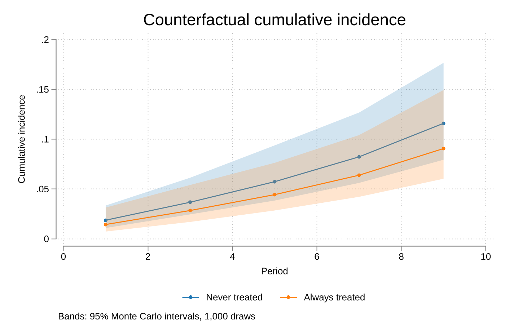
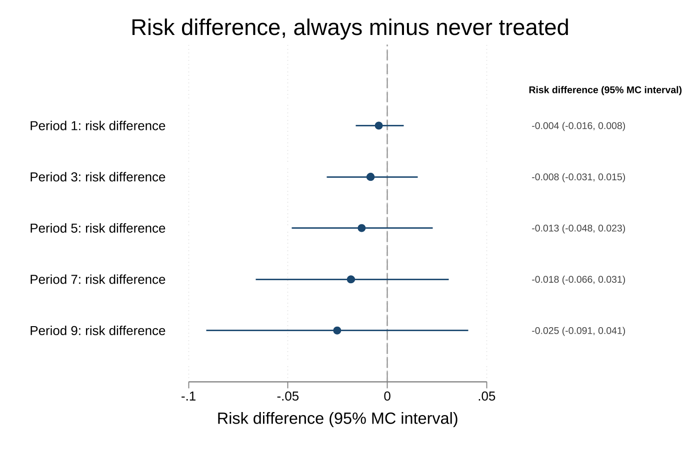
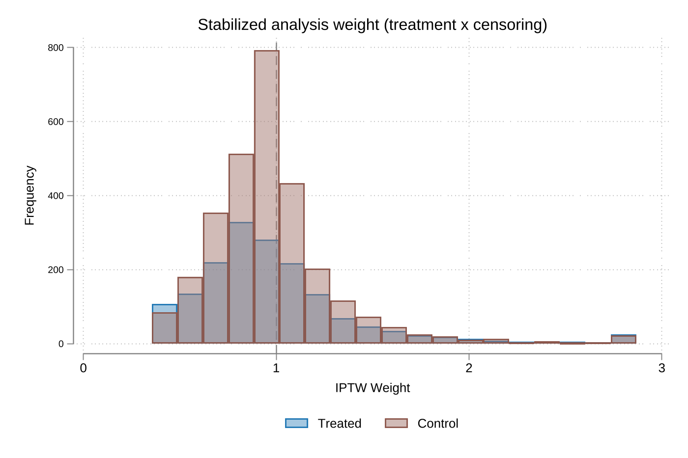
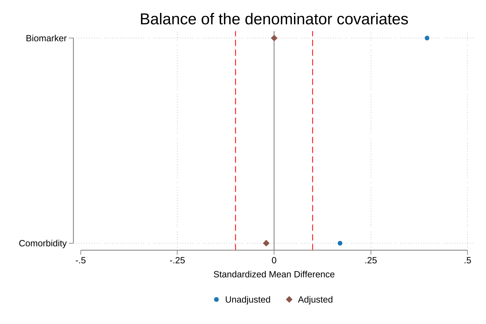

<p align="center"></p>

# msm — Marginal structural models with IPTW, end to end

**Version 2.0.0** | 2026-10-20

[](#version-history) [](#requirements) [](../LICENSE) [](../README.md)

**[Quick Start](#quick-start)** · **[Installation](#installation)** · **[Worked Examples](#worked-examples)** · **[Command Reference](#command-reference)** · **[Stata-Tools](../README.md)** · **[Report a bug](https://github.com/tpcopeland/Stata-Tools/issues)**

`msm` estimates marginal structural models for long person-period data with a time-varying treatment and time-varying confounding. It takes you from variable mapping through stabilized inverse-probability weights, longitudinal diagnostics, and a weighted outcome model to standardized risks under always-treated and never-treated strategies; companion packages make the tables and figures.

## Quick Start

After [installing](#installation), use the bundled person-period example to fit a pooled logistic MSM and obtain counterfactual cumulative-incidence predictions:

```stata
capture confirm file msm_example.dta
if _rc net get msm, from("https://raw.githubusercontent.com/tpcopeland/Stata-Tools/main/msm") replace
use msm_example.dta, clear

msm_prepare, id(id) period(period) treatment(treatment) outcome(outcome) ///
    covariates(biomarker comorbidity) baseline_covariates(age sex)
msm_weight, treat_d_cov(biomarker comorbidity age sex) ///
    treat_n_cov(age sex) truncate(1 99) nolog
msm_diagnose
msm_fit, model(logistic) outcome_cov(age sex) nolog
msm_predict, times(1 3 5 7 9) difference samples(500) seed(12345)
```

`msm_predict` compares standardized cumulative incidence under always-treated and never-treated strategies. The [Demo](#demo) section shows the figures and tables the demo script draws from the same data.

## Features

- **Standardized risks under static strategies.** `msm_predict` returns cumulative incidence (or survival, `type(survival)`) under always-treated and never-treated strategies and, with `difference`, the always-minus-never contrast in `r(rd)`, with Monte Carlo intervals drawn from the outcome model's coefficient covariance.
- **Stabilized IPTW and IPCW.** `msm_weight` fits the treatment and optional censoring models with the prior treatment added automatically, linear to natural-spline time bases, and percentile truncation; failed fits and probabilities at 0 or 1 are errors unless you name a fallback policy.
- **Diagnostics built for longitudinal data.** `msm_diagnose` reports treatment balance within period and prior-treatment history, censoring balance, and a positivity floor on the probability of the treatment actually observed; numerator covariates are flagged, not counted as imbalanced.
- **Weighted pooled logistic, linear, or Cox models.** `msm_fit` clusters sandwich standard errors on the subject identifier by default, adds treatment-history terms (`lag1`, `cumulative`, `duration`, `interaction`), and leaves the native `glm`, `regress` or `stcox` result in `e()`.
- **State that travels with the data.** The mapping and a signed contract for each stage are stored in dataset characteristics; `msm, status` reports the current stage and the next command, and re-running `msm_prepare` clears what no longer applies.
- **Graph-ready results.** `msm_predict, frame()` writes one row per period and quantity in the schema `eplot` reads, so tables (`regtab`, `effecttab`), figures, and E-values (`qba_confound`) come from the companion packages.

## Requirements

- Stata 16 or later
- The core commands need no other package.
- Optional companions for tables, diagnostics, figures and E-values: [`tabtools`](../tabtools), [`psdash`](../psdash), [`eplot`](../eplot), [`swimlane`](../swimlane) and [`qba`](../qba), all from Stata-Tools. `psdash` must be 1.8.0 or later to read data weighted by msm 2.0.0.

## Installation

```stata
capture ado uninstall msm
net install msm, from("https://raw.githubusercontent.com/tpcopeland/Stata-Tools/main/msm") replace
```

Uninstall first when upgrading from 1.4.x: `net install, replace` does not delete files that a new version no longer ships. If `ado uninstall msm` reports that more than one package matches, run `ado dir` and uninstall each `msm` entry by its number, highest first.

Download the example dataset into the working directory:

```stata
net get msm, from("https://raw.githubusercontent.com/tpcopeland/Stata-Tools/main/msm") replace
```

Install the companions you need the same way, for example:

```stata
foreach p in tabtools psdash eplot qba swimlane {
    net install `p', from("https://raw.githubusercontent.com/tpcopeland/Stata-Tools/main/`p'") replace
}
```

## Commands

| Command | Description |
|---------|-------------|
| `msm` | Overview, companion map, and `msm, status` for the pipeline state |
| `msm_prepare` | Map ID, period, treatment, outcome, censoring and covariates; refuse invalid person-period data; report data checks |
| `msm_weight` | Stabilized treatment weights and optional censoring weights |
| `msm_diagnose` | Balance by period and prior treatment, censoring balance, and positivity |
| `msm_fit` | Weighted pooled logistic, linear, or Cox outcome model |
| `msm_predict` | Standardized risks under always and never treated, risk differences, and a graph-ready frame |

`msm_protocol`, `msm_validate`, `msm_plot`, `msm_report`, `msm_table`, `msm_diagtab` and `msm_sensitivity` were removed in 2.0.0. They remain installed as stubs for all of 2.x; each prints its replacement and exits with return code 199.

## How It Works

`msm` stores the variable mapping and a signed contract for each stage in dataset characteristics. `msm_weight` and `msm_fit` verify that the data still match the stage they build on before using it, and re-running `msm_prepare` clears every downstream weight and fit artifact. `msm_diagnose` and `msm_predict` only read: their results are in `r()` (and `msm_predict, frame()`), so nothing they produce can go stale.

```text
msm_prepare → msm_weight → msm_diagnose → msm_fit → msm_predict
                  │              │            │           │
               psdash         psdash       regtab     effecttab · eplot · twoway
                                           qba_confound
```

`msm_weight` creates `_msm_weight` (treatment × censoring weight, the one `msm_fit` uses), `_msm_tw_weight`, optional `_msm_cw_weight`, the propensity score `_msm_ps`, the raw and used model probabilities, and `_msm_decision_risk`, which marks the rows that are real treatment decisions. Post-event and post-censoring rows carry the last weight forward but stay out of every fit and summary.

Run `msm, status` at any point to see the stage, the mapping, and the next step.

## Choosing a Workflow

| Goal | Workflow |
|------|----------|
| Standardized risks and risk differences | `msm_prepare`, `msm_weight`, `msm_diagnose`, `msm_fit, model(logistic)`, `msm_predict` |
| Weighted identity-scale effect | `msm_fit, model(linear)`; the treatment coefficient is a period-specific probability difference, not a standardized risk difference |
| Weighted hazard ratio | `msm_fit, model(cox)`; prediction is unavailable, report `e()` |
| Delayed or cumulative treatment effects | `msm_fit, history(lag1 cumulative duration interaction)`; still prediction-compatible |
| Continuous treatment-history summary | `msm_fit, exposure(varname)` and, where appropriate, `tvcov(varlist)`; estimation only |

### Replacements for the removed commands

| Task (former command) | Replacement |
|-----------------------|-------------|
| Coefficient table (`msm_table`, `msm_report`) | `collect: msm_fit ...` then `regtab` (tabtools) |
| Risk-difference table | `msm_predict, difference` then `matrix RD = r(rd)` and `effecttab, from(RD)` (tabtools) |
| Raw matrix export | `puttab using file.xlsx, matrix(name)` (tabtools) |
| Weight distribution (`msm_plot`, `msm_diagnose` pooled block) | `psdash weights treatment _msm_ps if _msm_decision_risk, wvar(_msm_weight)` |
| Per-period weights (`msm_diagnose, by_period`) | `psdash combined` |
| Pooled balance and Love plot (`msm_plot`) | `psdash balance ..., covariates(denominator covariates) wvar(_msm_weight) loveplot` |
| Risk curve (`msm_plot, type(survival)`) | `msm_predict, frame()` then `twoway` |
| Risk-difference forest plot | `msm_predict, frame()` then `eplot if strategy == "rd", frame()` |
| Treatment trajectories (`msm_plot`) | `swimlane` |
| E-value (`msm_sensitivity`) | `qba_confound, from_model coef(treatment) evalue measure(HR)` (qba) |
| Data checks (`msm_validate`) | Refusals and `r()` notes in `msm_prepare` and `msm_weight`; positivity in `msm_diagnose` |
| Protocol (`msm_protocol`) | None; record it in the manuscript or a protocol document |
| Cross-contrast export (`msm_diagtab`) | None; `frame post` the returns and `puttab, frame()` |

## Worked Examples

### 1. Prediction with censoring weights

```stata
use msm_example.dta, clear
msm_prepare, id(id) period(period) treatment(treatment) outcome(outcome) ///
    censor(censored) covariates(biomarker comorbidity) baseline_covariates(age sex)
msm_weight, treat_d_cov(biomarker comorbidity age sex) treat_n_cov(age sex) ///
    censor_d_cov(biomarker comorbidity age sex) censor_n_cov(age sex) ///
    truncate(1 99) nolog
msm_diagnose, threshold(0.1)
msm_fit, model(logistic) outcome_cov(age sex) period_spec(quadratic) nolog
msm_predict, times(1 3 5 7 9) difference samples(500) seed(12345) frame(pred, replace)
matrix list r(rd)
```

`msm_diagnose` reports balance within each period and prior-treatment stratum. Age and sex are in `treat_n_cov()`, so the stabilized weights keep their distribution on purpose: they appear as `target=0` and are flagged `(numerator)` in the pooled table rather than counted as imbalanced.

### 2. Tables

```stata
collect clear
collect: msm_fit, model(logistic) outcome_cov(age sex) period_spec(quadratic) nolog
regtab, xlsx("msm_results.xlsx") sheet("Outcome model") coef(OR)

msm_predict, times(1 3 5 7 9) difference samples(500) seed(12345)
matrix RD = r(rd)
effecttab, from(RD) effect("Risk difference") xlsx("msm_results.xlsx") sheet("Risk differences")
```

`r(rd)` holds estimate, lower and upper Monte Carlo limits, and an empty p-value column, the layout `effecttab, from()` reads. Any other returned matrix goes to Excel with `puttab using msm_results.xlsx, matrix(name) sheet(name)`.

### 3. Weight and balance diagnostics with psdash

```stata
psdash combined
psdash weights treatment _msm_ps if _msm_decision_risk, wvar(_msm_weight) detail graph
psdash balance treatment _msm_ps if _msm_decision_risk, ///
    covariates(biomarker comorbidity) wvar(_msm_weight) loveplot
```

`psdash combined` reads the msm contract, restricts to the decision risk set and diagnoses the analysis weight `_msm_weight` by default. Pass only denominator covariates to the Love plot; numerator covariates are not balance targets. `psdash` standardizes the weighted SMD by the unweighted pooled SD (the `cobalt` default) while `msm_diagnose` uses the weighted SD (Austin and Stuart 2015, section 4.1.1), so the two can differ slightly near a threshold.

### 4. Figures

```stata
msm_predict, times(1 3 5 7 9) difference samples(500) seed(12345) frame(pred, replace)
eplot if strategy == "rd", frame(pred) values xline(0)

frame pred: twoway ///
    (rarea ll ul horizon if strategy == "never", pstyle(p1) color(%25) lwidth(none)) ///
    (connected estimate horizon if strategy == "never", pstyle(p1)) ///
    (rarea ll ul horizon if strategy == "always", pstyle(p2) color(%25) lwidth(none)) ///
    (connected estimate horizon if strategy == "always", pstyle(p2)), ///
    legend(order(2 "Never treated" 4 "Always treated")) ///
    ytitle("Cumulative incidence") xtitle("Period")
```

The frame has one row per period and quantity (`strategy` is `never`, `always` or `rd`) with `label`, `estimate`, `ll`, `ul` and `rowtype`, eplot's frame schema. Treatment histories: `generate pstop = period + 1`, then `swimlane, id(id) start(period) stop(pstop) state(treatment)`.

### 5. E-value for unmeasured confounding

```stata
msm_fit, model(logistic) outcome_cov(age sex) period_spec(quadratic) nolog
qba_confound, from_model coef(treatment) evalue measure(HR)
```

The pooled-logistic odds ratio is a ratio of per-period odds, close to a discrete-time hazard ratio when the per-period risk is small; hence `measure(HR)`. Add `commonoutcome` when the cumulative incidence at the end of follow-up is 15% or more.

### 6. Cox estimation without prediction

```stata
use msm_example.dta, clear
msm_prepare, id(id) period(period) treatment(treatment) outcome(outcome) ///
    covariates(biomarker comorbidity) baseline_covariates(age sex)
msm_weight, treat_d_cov(biomarker comorbidity age sex) treat_n_cov(age sex) nolog
collect clear
collect: msm_fit, model(cox) outcome_cov(age sex) nolog
regtab, coef(HR)
```

## Demo

`demo/demo_msm.do` regenerates the figures and the results workbook below from `msm_example.dta`. It is a checkout workflow, not part of `net install`.

| Output | Command focus |
|--------|---------------|
|  | `msm_predict, frame()` and `twoway` |
|  | `eplot, frame()` |
|  | `psdash weights` |
|  | `psdash balance, loveplot` |
| [Results workbook](demo/msm_tables.xlsx) | `regtab` and `effecttab` |

The console transcripts of the demo are [`demo/console_pipeline.md`](demo/console_pipeline.md) (`msm_prepare`, `msm_weight`, `psdash combined`, `msm_diagnose`) and [`demo/console_results.md`](demo/console_results.md) (`msm_fit`, `regtab`, `msm_predict`, `effecttab`, `qba_confound`).

## Command Reference

Square brackets mark optional syntax; `help command` in Stata has the full narrative.

### `msm`

Syntax: ``msm [, list detail status]``

- `list` prints the five estimator commands; `detail` describes them and the companion map; `status` reports the verified stage, mapping and artifacts. At most one may be given. `protocol` was removed in 2.0.0.

### `msm_prepare`

Syntax: ``msm_prepare, id(varname) period(varname) treatment(varname) outcome(varname) [censor(varname) covariates(varlist) baseline_covariates(varlist)]``

- Refuses an empty dataset, missing `id()` or `period()`, duplicate `id()`-`period()` rows, non-integer periods, non-binary treatment, outcome or censoring, same-period event and censoring, and baseline covariates that vary within individual.
- Reports, without refusing, individuals with non-consecutive periods, mapped variables with missing values, covariates without variation, and the size of the smallest period (`r(n_gap_ids)`, `r(missing_vars)`, `r(constant_covariates)`, `r(min_period_n)`).

### `msm_weight`

Syntax: ``msm_weight [, treat_d_cov(varlist) treat_n_cov(varlist) censor_d_cov(varlist) censor_n_cov(varlist) period_d_spec(spec) period_n_spec(spec) truncate(numlist) fitfailure(policy) probpolicy(policy) clip(#) preview replace nolog]``

- `treat_d_cov()` defaults to the prepared time-varying plus baseline covariates; `treat_n_cov()` defaults to none, leaving an intercept and the automatically added lagged treatment.
- `censor_d_cov()` enables IPCW and requires a mapped `censor()`; `censor_n_cov()` requires `censor_d_cov()`.
- `period_d_spec()` defaults to `linear` and `period_n_spec()` to `none`; each accepts `none`, `linear`, `quadratic`, `cubic`, or `ns(#)`.
- `truncate()` is off by default; `truncate(1)` is shorthand for `truncate(1 99)`.
- `fitfailure()` and `probpolicy()` default to `error`; `fitfailure(marginal)` and `probpolicy(clip) clip(#)` are explicit sensitivity policies.
- `preview` resolves the specification without fitting; `replace` overwrites existing `_msm_*` weight variables.

### `msm_diagnose`

Syntax: ``msm_diagnose [, balance_covariates(varlist) threshold(#) positivity(#)]``

- `balance_covariates()` defaults to all covariates registered by `msm_prepare`; with none at all the command refuses.
- `threshold()` defaults to `0.1`; `positivity()` defaults to `0.01` and is applied to the smallest probability of the treatment actually observed.

### `msm_fit`

Syntax: ``msm_fit [, model(string) outcome_cov(varlist) exposure(varname) tvcov(varlist) history(string) period_spec(string) cluster(varname) vce(string) strata(varlist) bootstrap(#) level(#) nolog]``

- `model()` defaults to `logistic` and accepts `logistic`, `linear`, or `cox`. The fit stays in `e()` as the native `glm`, `regress` or `stcox` result.
- `outcome_cov()` adds time-fixed outcome covariates; every numerator covariate must appear here or, for Cox, in `strata()`.
- `history()` accepts `lag1`, `cumulative`, `duration`, `interaction`; `period_spec()` defaults to `quadratic` and accepts `none`, `linear`, `quadratic`, `cubic`, or `ns(#)`.
- `vce()` defaults to sandwich SEs clustered at the mapped ID. `bootstrap()` is reserved.

### `msm_predict`

Syntax: ``msm_predict, times(numlist) [strategy(string) type(string) samples(#) seed(#) level(#) difference extrapolate frame(name[, replace])]``

- `strategy()` defaults to `both`; `type()` to `cum_inc` (or `survival`); `samples()` to 100 draws (at least 10; use 500 or more for published intervals).
- `difference` adds the always-minus-never contrast: `r(rd)` and `r(rd_#)`, or `r(sd)` and `r(sd_#)` under `type(survival)`. A negative period `t` is named `m#` (`r(rd_m2)`, row `tm2`).
- `frame()` writes one graph-ready row per period and quantity; an existing frame needs `replace`.
- `extrapolate` allows times beyond the fitted risk-set support.

## Options

The flagship `msm` takes the first four options (`protocol` is still parsed so that it can refuse with a pointer to the manuscript; it was removed in 2.0.0). The remaining rows list the options of the five estimator commands.

| Option | Command | Meaning |
|--------|---------|---------|
| `list` | `msm` | Print the five estimator commands |
| `detail` | `msm` | Describe the commands and the companion map |
| `status` | `msm` | Report the verified stage, mapping and artifacts |
| `protocol` | `msm` | Removed in 2.0.0; refuses with return code 198 |
| `id(varname)` | `msm_prepare` | Individual identifier (required) |
| `period(varname)` | `msm_prepare` | Integer period variable (required) |
| `treatment(varname)` | `msm_prepare` | Binary treatment (required) |
| `outcome(varname)` | `msm_prepare` | Binary outcome (required) |
| `censor(varname)` | `msm_prepare` | Binary censoring indicator |
| `covariates(varlist)` | `msm_prepare` | Time-varying covariates |
| `baseline_covariates(varlist)` | `msm_prepare` | Time-fixed baseline covariates |
| `treat_d_cov(varlist)` | `msm_weight` | Treatment denominator covariates |
| `treat_n_cov(varlist)` | `msm_weight` | Treatment numerator covariates |
| `censor_d_cov(varlist)` | `msm_weight` | Censoring denominator covariates; enables IPCW |
| `censor_n_cov(varlist)` | `msm_weight` | Censoring numerator covariates |
| `period_d_spec(spec)` | `msm_weight` | Denominator time basis (default `linear`) |
| `period_n_spec(spec)` | `msm_weight` | Numerator time basis (default `none`) |
| `truncate(numlist)` | `msm_weight` | Percentile truncation; off by default |
| `fitfailure(policy)` | `msm_weight` | Failed-fit policy (default `error`) |
| `probpolicy(policy)` | `msm_weight` | Probability-support policy (default `error`) |
| `clip(#)` | `msm_weight` | Clip bound for `probpolicy(clip)` |
| `preview` | `msm_weight` | Resolve the specification without fitting |
| `replace` | `msm_weight` | Overwrite existing `_msm_*` weight variables |
| `nolog` | `msm_weight`, `msm_fit` | Suppress iteration logs |
| `balance_covariates(varlist)` | `msm_diagnose` | Covariates to balance |
| `threshold(#)` | `msm_diagnose` | SMD threshold (default 0.1) |
| `positivity(#)` | `msm_diagnose` | Positivity floor (default 0.01) |
| `model(string)` | `msm_fit` | `logistic` (default), `linear` or `cox` |
| `outcome_cov(varlist)` | `msm_fit` | Time-fixed outcome covariates |
| `exposure(varname)` | `msm_fit` | Continuous treatment-history summary |
| `tvcov(varlist)` | `msm_fit` | Time-varying companion terms |
| `history(string)` | `msm_fit` | `lag1`, `cumulative`, `duration`, `interaction` |
| `period_spec(string)` | `msm_fit` | Outcome time basis (default `quadratic`) |
| `cluster(varname)` | `msm_fit` | Cluster variable (default the mapped ID) |
| `vce(string)` | `msm_fit` | Variance estimator |
| `strata(varlist)` | `msm_fit` | Cox strata |
| `bootstrap(#)` | `msm_fit` | Reserved |
| `level(#)` | `msm_fit`, `msm_predict` | Confidence level |
| `times(numlist)` | `msm_predict` | Periods to predict (required) |
| `strategy(string)` | `msm_predict` | Strategy (default `both`) |
| `type(string)` | `msm_predict` | `cum_inc` (default) or `survival` |
| `samples(#)` | `msm_predict` | Monte Carlo draws (default 100) |
| `seed(#)` | `msm_predict` | Random-number seed |
| `difference` | `msm_predict` | Always-minus-never contrast |
| `extrapolate` | `msm_predict` | Allow times beyond the fitted support |
| `frame(name[, replace])` | `msm_predict` | Write a graph-ready frame |

## Stored Results

### `msm`

`r(version)`, `r(commands)`, `r(removed)` and `r(n_commands)`. With `status`: `r(stage)`, `r(next_step)`, `r(model)`, the mapping macros `r(id)`, `r(period)`, `r(treatment)`, `r(outcome)`, `r(censor)`, `r(covariates)`, `r(baseline_covariates)`, and `r(prepared)`, `r(weighted)`, `r(fitted)`.

### `msm_prepare`

Scalars `r(N)`, `r(n_ids)`, `r(n_periods)`, `r(period_span)`, `r(n_events)`, `r(n_treated)`, `r(n_censored)`, `r(n_gap_ids)`, `r(min_period_n)`; macros `r(id)`, `r(period)`, `r(treatment)`, `r(outcome)`, `r(censor)`, `r(covariates)`, `r(baseline_covariates)`, `r(missing_vars)`, `r(constant_covariates)`.

### `msm_weight`

After fitting: `r(mean_weight)`, `r(sd_weight)`, `r(min_weight)`, `r(max_weight)`, `r(p1_weight)`, `r(median_weight)`, `r(p99_weight)`, `r(ess)` (risk set), `r(n_truncated)`, `r(n_fitfail_fallback)`, `r(fitfailure_fallback)`, `r(n_probability_repairs)`, the matrix `r(probability_repairs)`, and the resolved specification macros. `preview` returns the resolved specification only.

### `msm_diagnose`

Scalars `r(threshold)`, `r(n_imbalanced)`, `r(n_numerator)`, `r(n_unavailable)`, `r(positivity_threshold)`, `r(n_positivity_violations)`, `r(min_obs_probability)`, `r(n_support_violations)`; macros `r(covariates)` and `r(support_violation_periods)`; matrices `r(treatment_balance)`, `r(support)`, optional `r(censor_balance)`, and the secondary pooled `r(balance)`.

### `msm_fit`

The standard results of `glm`, `regress` or `stcox`, plus `e(msm_cmd)`, `e(msm_model)`, `e(msm_treatment)`, `e(msm_exposure)`, `e(msm_tvcov)`, `e(msm_history_spec)`, `e(msm_history_assumption)`, `e(msm_period_spec)`, `e(msm_vce)`, `e(msm_cluster)`, `e(msm_strata)`, `e(msm_inf_dist)`, `e(msm_inf_df)`, `e(msm_n_clusters)`, `e(msm_n_dropped)` and the matrix `e(effects)`.

### `msm_predict`

Matrices `r(predictions)` and, with `difference`, `r(rd)` or `r(sd)`; scalars `r(n_times)`, `r(n_ref)`, `r(samples)`, `r(level)`, `r(min_support)`, `r(max_support)`, `r(extrapolated)`, and `r(rd_#)` or `r(sd_#)`; macros `r(seed)`, `r(seed_source)`, `r(seed_state)`, `r(type)`, `r(strategy)`, `r(history_spec)`, `r(diff_type)`, `r(draw_method)`, `r(frame)`.

## Assumptions and Limits

- The causal interpretation requires consistency, sequential exchangeability given the measured history, positivity, and adequate treatment, censoring and marginal outcome models. The commands diagnose parts of these conditions but cannot establish them.
- Data must be long person-period data with unique `id()`-`period()` rows, integer periods, binary treatment and outcome, and a common baseline. Delayed entry is not supported.
- Treatment is meant to vary over time; for a single baseline treatment use `teffects ipw`.
- Prediction supports only static always-treated and never-treated strategies.
- The weight models add only the immediately prior treatment automatically. Build richer histories yourself and put them in `treat_d_cov()` and, where relevant, `censor_d_cov()`.
- `outcome_cov()` variables must be time-fixed, and numerator covariates must enter the outcome model.
- `exposure()` and `tvcov()` are for treatment-history-derived terms and disable `msm_predict`.
- The censoring models condition on current treatment (within-period order L, A, C, Y), which differs from the printed sw-dagger formula in Hernán, Brumback and Robins (2000).
- `msm_fit` standard errors and `msm_predict` Monte Carlo intervals condition on the estimated weights; they do not propagate weight-model estimation.

## Troubleshooting

| Symptom | Response |
|---------|----------|
| A removed command prints "was removed in msm 2.0.0" | Use the replacement it names; see Companion Packages |
| `msm_prepare` notes gaps | `msm_weight` will refuse them; expand the grid or drop the incomplete individuals |
| `msm_weight` rejects delayed entry | Align the panel to a shared baseline |
| Weight means or ESS are poor | Inspect the treatment histories, `psdash combined`, and `r(support)` before a justified truncation or model revision |
| `msm_weight` reports probability support failure | Investigate missing predictors, separation and positivity first; `probpolicy(clip) clip(#)` only as a named sensitivity analysis |
| Balance remains poor | Inspect `r(treatment_balance)` by period and prior treatment; numerator covariates (`target=0`) are not expected to balance |
| `msm_predict` refuses | Confirm a logistic fit without `exposure()`/`tvcov()` and `times()` within the fitted support |

## References

- Robins JM, Hernan MA, Brumback B. Marginal structural models and causal inference in epidemiology. *Epidemiology*. 2000;11(5):550-560.
- Hernan MA, Brumback B, Robins JM. Marginal structural models to estimate the causal effect of zidovudine on the survival of HIV-positive men. *Epidemiology*. 2000;11(5):561-570.
- Cole SR, Hernan MA. Constructing inverse probability weights for marginal structural models. *American Journal of Epidemiology*. 2008;168(6):656-664.
- Austin PC, Stuart EA. Moving towards best practice when using inverse probability of treatment weighting using the propensity score to estimate causal treatment effects in observational studies. *Statistics in Medicine*. 2015;34(28):3661-3679. doi:10.1002/sim.6607.
- Adenyo D, Guertin JR, Candas B, Sirois C, Talbot D. Evaluation and comparison of covariate balance metrics in studies with time-dependent confounding. *Statistics in Medicine*. 2024. doi:10.1002/sim.10188.
- VanderWeele TJ, Ding P. Sensitivity analysis in observational research: introducing the E-value. *Annals of Internal Medicine*. 2017;167(4):268-274.
- Hernan MA, Robins JM. *Causal Inference: What If*. Boca Raton: Chapman & Hall/CRC, 2020.

## QA

QA suites and how to run them are documented in [`qa/README.md`](qa/README.md).

## Version History

- **2.0.0** (2026-10-13): Breaking. msm is now the estimator core: `msm_prepare`, `msm_weight`, `msm_diagnose` (longitudinal balance and positivity), `msm_fit` and `msm_predict`. Removed `msm_protocol`, `msm_validate`, `msm_plot`, `msm_report`, `msm_table`, `msm_diagtab` and `msm_sensitivity`; running one prints its replacement (tabtools `regtab`/`effecttab`/`puttab`, `psdash`, `eplot`, `swimlane`, `qba_confound`) and exits with return code 199, and the stubs stay for all of 2.x. `msm_diagnose` no longer prints pooled weight summaries (use `psdash`) or accepts `by_period` or `accumulate()`; it adds `r(covariates)`, flags numerator covariates in the pooled table instead of counting them as imbalanced, and flags periods with no treated or no untreated row. `msm_prepare` reports gaps, missing values, constant covariates and sparse periods in `r()`. `msm_predict` adds `frame()` and `r(rd)`, writes nothing to the dataset, and returns `r(rd_m#)` for negative periods (it failed with r(101) before). `msm_weight` writes contract 1.1 (`_msm_risk_var`) so `psdash` restricts to the decision risk set, and prints truncation percentiles as 1st/99th; data weighted by 2.0.0 needs psdash 1.8.0 or later. With no covariates mapped in `msm_prepare`, `msm_diagnose` balances the `treat_d_cov()` covariates. Run `ado uninstall msm` before installing.
- **1.4.12** (2026-10-09): Help References now give a DOI for every entry.
- **1.4.11** (2026-09-30): Failed `msm_prepare` and `msm_weight` calls restore the caller's original sort metadata as well as its physical row order. Protocol descriptions retain literal quotes, macro-like text and Unicode in display, returned text and exported files. Report text and CSV numbers retain the requested decimal precision. Failed predictions preserve the caller's RNG state, returned results and prediction identifier counter. Weighting preserves active estimation results and restores caller returned results, RNG state and the identifier counter on failure. Guard and operational refusals in the dispatcher, preparation, validation, diagnosis, fitting, plotting, reporting, protocol and sensitivity commands preserve caller returned results. Validation retains its documented findings on a completed strict check. Commands that temporarily sort data restore the original sort keys and row order.

<details>
<summary>Earlier versions</summary>

- **1.4.10** (2026-09-27): `msm_weight, truncate()` counts and caps weights at the exact percentile cutoffs, and `msm_diagnose` counts extreme weights above the exact P99. The cutoffs used to pass through a macro, which could move them by one unit in the last place, so a weight equal to the cutoff was counted as truncated and rewritten slightly off it (off by one in `r(n_truncated)` on ordinary data). `msm_diagnose` no longer prints its imbalanced count when run quietly.
- **1.4.9** (2026-09-26): The effective sample size reported by `msm_weight`, `msm_diagnose` (overall, by treatment group, and in `r(support)`, `r(treatment_balance)` and `r(censor_balance)`) and `msm_report`, and the weighted SMD of a continuous covariate, no longer become missing when the weights are extremely small or large (near 1e-200 or 1e200, where their squares underflow or overflow); both are computed on weights divided by a power of two. Ordinary weights give the same values to within the last digit or two.
- **1.4.8** (2026-08-30): Guarded auto-open paths against shell metacharacters, made accumulated diagnostics fail before state changes on incompatible frames, restored caller abbreviation settings on helper early returns, and corrected Viewer-width help tables.
- **1.4.7** (2026-08-28): Vectorized counterfactual prediction and Monte Carlo simulation in Mata while preserving seeded results, reducing realistic `msm_predict` runtimes by more than tenfold.
- **1.4.6** (2026-08-11): Bound downstream artifacts to their owning fit or weights, persisted prediction and balance matrices with saved datasets, corrected fitted-sample sensitivity incidence and RR-scale labels, and exported confounding-strength assumptions and bounds.
- **1.4.5** (2026-08-05): Made seeded Monte Carlo prediction intervals reproducible across numerically equivalent refits by using the symmetric positive-semidefinite covariance square root.
- **1.4.4** (2026-08-05): Refused rank-deficient fitted specifications before committing package state and corrected stored-result documentation.
- **1.4.3** (2026-07-29): Hardened empty-dataset handling in `msm_prepare` and aligned the flagship version readout with its shipped header.
- **1.4.2** (2026-07-28): Corrected weighted SMD definitions, risk-set plotting, signed-period survival plots, diagnostic reuse, and interpretation of fitted support and conditional Monte Carlo intervals.
- **1.4.1** (2026-07-27): Refined installed help and documentation contracts for the released user surface.
- **1.4.0** (2026-07-26): Added configurable denominator and numerator time bases, including natural cubic splines, with prior-weight-preserving defaults.
- **1.3.0** (2026-07-25): Corrected observed-treatment positivity diagnostics, risk-set pooling, observation-order restoration, and fitted-sample metadata.
- **1.2.4** (2026-07-23): Improved Excel export failure propagation and contextual interpretation of E-values and confounding bounds.
- **1.2.3** (2026-07-04): Improved the failure message for time-invariant treatment processes and documented the baseline-treatment alternative.
- **1.2.2** (2026-07-02): Corrected protective-effect sensitivity bounds, natural-spline edge cases, Excel title handling, weight-specification display, and missing SMD reporting.
- **1.2.1** (2026-06-25): Added a known-truth recovery workflow for the marginal structural log-odds.
- **1.2.0** (2026-06-17): Added continuous exposure and time-varying companion terms for estimation-only dose-duration analyses.
- **1.1.0** (2026-06-14): Added the retained per-period propensity variable and the optional `psdash` diagnostic contract.
- **1.0.4** (2026-05-29): Added accumulated cross-contrast weight diagnostics and the `msm_diagtab` Excel export.
- **1.0.3** (2026-05-06): Added explicit `vce()` control and Cox `strata()` support.
- **1.0.2** (2026-05-06): Hardened state invalidation, missing-weight handling, export restoration, and binary-outcome scope guidance.
- **1.0.1** (2026-04-30): Hardened validation edge cases, time-fixed outcome-covariate enforcement, Cox guidance, and protocol export escaping.
- **1.0.0** (2026-04-26): Initial Stata-Tools release of the MSM workflow suite.

</details>

## Author

Timothy P Copeland, Karolinska Institutet

Questions and bug reports: [GitHub issues](https://github.com/tpcopeland/Stata-Tools/issues). Please include the first line of `which msm` and your Stata version.

To cite: Copeland TP. *msm: Marginal structural models with IPTW, end to end*. Stata-Tools, https://github.com/tpcopeland/Stata-Tools/tree/main/msm. Please give the version you used (`which msm` prints it).

## License

MIT (see [LICENSE](../LICENSE))
