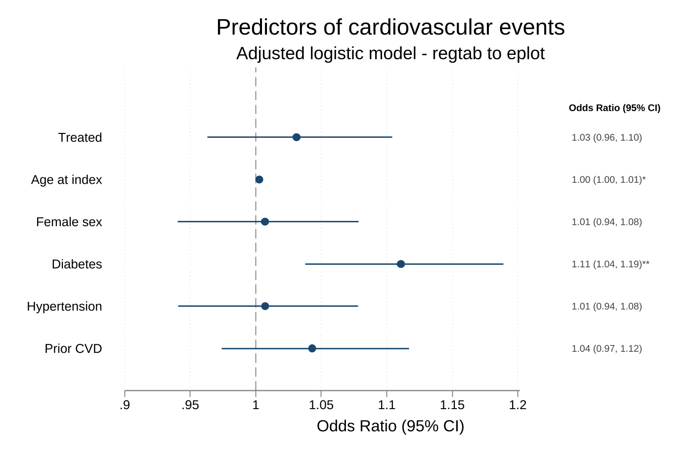
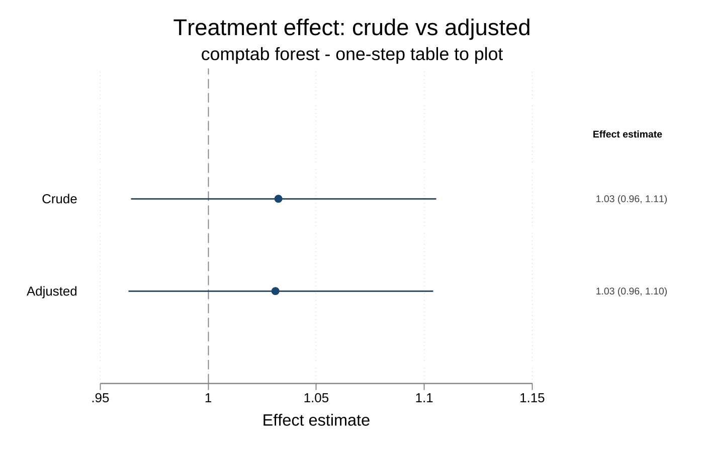

<p align="center"></p>

# tabtools — Manuscript tables to Excel and Markdown

**Version 1.0.0** | 2026-10-20

[ [](#requirements) [](../LICENSE) [](../README.md)

**[Quick Start](#quick-start)** · **[Installation](#installation)** · **[Commands](#commands)** · **[Worked Examples](#worked-examples)** · **[Stata-Tools](../README.md)** · **[Report a bug](https://github.com/tpcopeland/Stata-Tools/issues)**

`tabtools` turns descriptive, model, survival, rate, and composite results into publication-ready Excel and GitHub-Flavored Markdown tables. Its commands share one set of output options, so the same rendered table can go to a workbook, a Markdown report, a CSV file, or a Stata frame.

## Quick Start

After [installing](#installation), build a baseline table from the synthetic cohort in the repository's `_data/` folder and write it as Markdown (the `replace treated` line is the demo's: it makes treatment depend on age, sex, diabetes, and hypertension, so the two arms differ at baseline):

```stata
use "https://raw.githubusercontent.com/tpcopeland/Stata-Tools/main/_data/cohort.dta", clear
merge 1:1 id using "https://raw.githubusercontent.com/tpcopeland/Stata-Tools/main/_data/treatment.dta", nogen keep(match)
merge 1:1 id using "https://raw.githubusercontent.com/tpcopeland/Stata-Tools/main/_data/comorbidities.dta", nogen keep(master match) nolabel
foreach v in diabetes hypertension {
    replace `v' = 0 if missing(`v')
}
set seed 20261005
replace treated = runiform() < invlogit(-2.4 + 0.05 * (index_age - 58) - 0.3 * female + 2.2 * diabetes + 2.0 * hypertension)
table1_tc, by(treated) vars(index_age contn %5.1f \ female bin \ diabetes bin \ hypertension bin) title("Table 1. Baseline Characteristics") markdown("table1.md")
```

`table1.md` holds exactly this (its `###` heading shown in bold here):

**Table 1. Baseline Characteristics**

| No. (Column %) or Mean±SD | SSRI (N=8,929) | SNRI (N=6,071) | p-value |
| --- | --- | --- | --- |
| Age at cohort entry (years) | 55.9±13.4 | 62.0±12.4 | \<0.001 |
| Female sex | 5,530 (62) | 3,442 (57) | \<0.001 |
| Diabetes | 2,566 (29) | 4,359 (72) | \<0.001 |
| Hypertension | 2,765 (31) | 4,282 (71) | \<0.001 |

<sub>The first table of `demo/demo_markdown_report.md`, written by `demo/demo_tabtools.do`, which then appends a `crosstab` and a `puttab` table to the same file with `mdappend`. The demo also merges the outcome file and builds variables this table does not use; they do not change it. The same call prints the table in the Results window, and `xlsx()` or `frame()` would send it to a workbook or a frame as well.</sub>

## Features

- **One set of output options.** A table command can write any of the targets it supports, `xlsx()`, `csv()`, `markdown()`, `frame()`, and, for model and effect tables, a graph-ready `eplotframe()`, from the same rendered table in one call.
- **Tables from the models you already ran.** `regtab` and `effecttab` format the active `collect` result of `regress`, `logistic`, `margins`, `teffects` and similar commands, and `comptab` combines their frames into one composite table.
- **Small-cell disclosure control.** `smallcells(#)` in `table1_tc`, `desctab`, and `crosstab` applies primary, complementary, and dependent-result suppression before any output is written, so every sink receives the same redacted table.
- **Confidence levels that are checked.** An explicit `level()` that conflicts with the level recorded in a collection or a saved `strate` file is an error, not a relabelled interval.
- **Shared house style.** `tabtools set` and `tabtools get` hold session defaults for font, font size, borders, colours, digits, and p-value emphasis, and `permanent` saves them to a runnable profile.

## Requirements

- Stata 17 or later
- No mandatory user-written Stata packages
- `regtab` and `effecttab` need an active Stata `collect` result created by commands such as `regress`, `logistic`, `margins`, or `teffects`; they format and arrange that collection rather than fitting a model
- `survtab` needs data declared with `stset`; `stratetab` reads `.dta` files written by Stata's `strate, output()` command
- Optional: the `eplot` package from Stata-Tools, for forest-plot output from `comptab` and `hrcomptab` and for plotting the `eplotframe()` outputs of `regtab` and `effecttab` (the table commands create those graph-ready frames without it)

## Installation

```stata
capture ado uninstall tabtools
net install tabtools, from("https://raw.githubusercontent.com/tpcopeland/Stata-Tools/main/tabtools") replace
```

If another copy is earlier on the `adopath`, inspect `ado dir` and remove only the `tabtools` package before reinstalling. The public distribution includes the command files, help files, package metadata, and table-of-contents entry; it does not include the repository's demo fixtures or generated demo workbooks.

## Commands

The suite contains 16 public commands. The version column is the minimum Stata release for that command.

| Command | Stata | Purpose |
| --- | ---: | --- |
| `table1_tc` | 17+ | Baseline Table 1 by group, with continuous, categorical, missingness, tests, and standardized mean differences |
| `desctab` | 17+ | Direct access to the consolidated descriptive engine used by `table1_tc` |
| `crosstab` | 17+ | Two-way categorical tables with percentages, tests, and 2x2 effect measures |
| `regtab` | 17+ | Render active regression collections with estimates, confidence intervals, statistics, and optional plot frames |
| `effecttab` | 17+ | Render active `margins` or `teffects` results, or a supplied effect matrix |
| `tabcell` | 17+ | Format one publication cell — estimate (CI), p-value, n (%), e/n (%), or median (Q1, Q3) — from a fit, `lincom`/`nlcom`, a matrix row, or numbers, or fill a string column |
| `outtab` | 17+ | Binary outcomes by exposure: events/N (%) per group plus one ratio column per model specification |
| `survtab` | 17+ | Kaplan–Meier survival, event, risk-set, median, RMST, and group-difference tables |
| `stratetab` | 17+ | Convert saved `strate, output()` rate files into rate and rate-ratio tables |
| `ratetab` | 17+ | Events, person-time, and rates by group from `stset` or event/exposure data, with exact, Poisson, or cluster-robust intervals |
| `hrcomptab` | 17+ | Compatibility wrapper for `comptab` rate-scaffold mode |
| `comptab` | 17+ | Combine model frames vertically or interlock them with a rate scaffold |
| `puttab` | 17+ | Put variables, a frame, or a matrix into a formatted workbook or Markdown table |
| `stacktab` | 17+ | Stack or place blocks from an existing workbook into a new worksheet |
| `tabtools` | 17+ | Inspect and set shared fonts, digits, borders, colors, and persistent profiles; session destinations (`tabtools set workbook`/`markdown`); fit-time counts (`tabtools fitcount`) |
| `tabtools_tips` | 17+ | Open or print a compact recipe reference for the suite |

## How It Works

Most table commands follow the same three-stage pattern: calculate or receive results, render a table in Results, then optionally export or expose that same rendered structure. The export targets are independent, so a command can write Excel, CSV, Markdown, a Stata frame, or an eplot-ready frame in one call when that command supports the target.

`xlsx()` is the main Excel option and `excel()` is retained as a synonym on commands that support both names. `sheet()` selects the worksheet. `open` opens an Excel target after writing it and therefore requires an `xlsx()` or `using` target. `csv()` exports the visible table data for commands that offer it; `markdown()` writes GitHub-Flavored Markdown, and `mdappend` appends to an existing Markdown file rather than replacing it.

`frame(name[, replace])` stores the rendered table in a Stata frame for later composition or inspection. `eplotframe(name[, replace])` stores graph-ready estimates, confidence limits, p-values, labels, and model identifiers for the model/effect commands that support it. `comptab` consumes compatible model/effect frames and, with `rateframe()`, a rate frame plus model frames; `hrcomptab` is the compatibility wrapper for that mode.

For plot-ready composition, create each display frame and its numeric companion in the same command call. Their pair identities must agree. Recreate older saved pairs with the current `regtab` or `effecttab` before requesting a composite plot frame.

Shared formatting options include `font()`, `fontsize()`, `borderstyle()`, `headershade`, `headercolor()`, `zebra`, `zebracolor()`, `title()`, `footnote()`, `boldp()`, and `highlight()` where supported. A fresh session resolves the shared baseline as Arial 10-point text with thin borders, while command-specific precision and display defaults are listed below.

### Workbook cell types

Every exported workbook cell is written as **text**, including cells that look numeric. This is deliberate: the majority of published table cells are composite or annotated strings — `5,351 (60)`, `0.82 (0.69, 0.98)`, `<0.001`, `0.54***`, `Reference` — and the commands render each cell to its final string before any sink runs. Re-deriving a numeric type by reparsing the rendered string would have to guess, and would silently convert an annotated cell into a number that no longer matches the table.

The practical consequence is that Excel will not sum, chart, or numerically sort a column of an exported sheet without a conversion step in Excel. For a numeric payload, use `frame()` (Stata frames, with the underlying numeric columns where a command provides them), the `r()` matrices such as `r(table)` and `r(cutoff_table)`, or `eplotframe()` for plotting.

## Choosing a Workflow

| Need | Start with | Add or follow with |
| --- | --- | --- |
| Baseline characteristics by one group variable | `table1_tc` | `smd`, `test`, `xlsx()`, `frame()` |
| Direct access to the Table 1 engine | `desctab` | the same syntax and options as `table1_tc` |
| Two categorical variables | `crosstab` | `rowpct`, `colpct`, `or`, `rr`, `rd`, `fisher`, `trend`, or `cochran` |
| Regression model collection | `regtab` | `stats()`, `keep()`/`drop()`, `eplotframe()`, or `frame()` |
| Marginal effects or treatment effects | `effecttab` | `from()`, `type()`, `clean`, `full`, or `eplotframe()` |
| Survival probabilities or RMST | `survtab` | `times()`, `by()`, `median`, `riskset`, `rmst()`, or `difference` |
| Incidence rates from `strate` | `stratetab` | `outlabels()`, `rateratio`, or a later `hrcomptab` |
| Several model/effect results | `comptab` | compatible source frames and `rows()` |
| Rates plus model estimates | `comptab` | `rateframe()`, `rows()`, and optional `forest` |
| A dataset, frame, or matrix as a table | `puttab` | `using`, `frame()`, `matrix()`, `varlabels`, or `noheader` |
| Existing Excel blocks | `stacktab` | `blocks()`, `layout(hstack)`, `append`, or `sheetreplace` |

## Worked Examples

### 1. Baseline table

```stata
sysuse auto, clear
table1_tc price mpg weight rep78, by(foreign) smd test frame(table1, replace) xlsx("table1.xlsx")
```

`table1_tc` detects the supplied variables when `vars()` is omitted. Use `vars()` for explicit row types such as `contn`, `conts`, `cat`, `bin`, and their extended forms; `smd` requires `by()`, and `clear` is available when the rendered table should replace the data in memory.

To protect exact counts below a publication threshold in `table1_tc`, `desctab`, or `crosstab`, add `smallcells(#)`. Primary cells are shown as `<#`, complementary cells as `≥#`, and dependent statistics as `Suppressed`. A missing or negative count that is not printed but follows from printed cells and sample sizes is protected in the same way. Every requested sink receives the same already-redacted table. After safety is certified, the engine deterministically removes complementary markers one at a time whenever the protected counts remain non-exact. Each remaining `≥#` is therefore individually necessary in the final table, although the result is not guaranteed to use the globally smallest possible number of complementary markers.

```stata
table1_tc rep78, by(foreign) vars(rep78 cat) total(after) smallcells(5) frame(table1_safe, replace)
```

### 2. Shared formatting profile

Use the controller to inspect the suite, set explicit formatting defaults, and save them for reuse in another session:

```stata
tabtools, detail category(models)
tabtools set font Arial
tabtools set fontsize 10
tabtools set borderstyle thin, permanent profile("tabtools_project.do")
tabtools use using "tabtools_project.do"
tabtools get
```

Use `tabtools, list` for the compact catalog, or replace `category(models)` with another catalog category. The profile contains ordinary `tabtools set` commands and can be version controlled with a project.

### 3. Consolidated descriptive engine

```stata
sysuse auto, clear
desctab price mpg weight rep78, by(foreign) smd test frame(descriptive, replace) xlsx("descriptive.xlsx")
```

`desctab` is the consolidated implementation behind `table1_tc`. It accepts the same variable-type, inference, suppression, weighting, formatting, and output options; `table1_tc` is the stable user-facing frontend.

### 4. Regression and effects

```stata
sysuse auto, clear
collect clear
collect: logistic foreign mpg weight
regtab, frame(regression, replace) eplotframe(regression_plot, replace) xlsx("regression.xlsx")

collect clear
collect: margins, at(mpg=(15 25 35))
effecttab, frame(effects, replace) xlsx("effects.xlsx")
```

`regtab` and `effecttab` format active collections; they do not fit models. Both can also feed a composite table, and their `eplotframe()` output can be plotted by the optional `eplot` package.

### 5. Categorical tables

```stata
sysuse auto, clear
crosstab foreign rep78, rowpct fisher smallcells(5) xlsx("crosstab.xlsx")
```

`crosstab` defaults to column percentages and uses a sparse-cell exact test when appropriate. With `smallcells(#)`, it protects the count block and margins, withholds percentages whose numerator or denominator is protected, and suppresses count-dependent tests and effect measures.

### 6. Survival and rates

```stata
webuse drugtr, clear
stset studytime, failure(died)
survtab, times(1 2 3) by(drug) median riskset xlsx("survival.xlsx")

webuse diet, clear
stset dox, failure(fail)
strate hienergy, per(1) output(rate_hienergy, replace)
stratetab, using("rate_hienergy") outcomes(1) xlsx("rates.xlsx")
```

`survtab` reports Kaplan–Meier quantities at the requested times. `stratetab` expects the saved `strate` files in exposure-major, outcome-minor order and uses `outcomes()` to interpret that file sequence.

### 7. Composite model table

```stata
sysuse auto, clear
collect clear
collect: regress price mpg weight
regtab, frame(model, replace)
collect clear
collect: regress price mpg weight length
regtab, frame(model2, replace)
comptab model model2, rows("1 2 \ 1 2") xlsx("composite.xlsx")
```

The source frames must contain compatible row labels. `rows()` takes one numeric row specification per source frame, separated by `\`; here `1 2 \ 1 2` selects the first two rows from both frames. Use `relabel()` or `section()` when the displayed row names or section structure need to be changed; use `hrcomptab` when one of the source frames is a `stratetab` rate frame.

### 8. Direct table output

```stata
sysuse auto, clear
puttab price mpg weight using "selected.xlsx", sheet("Table") varlabels
puttab price mpg weight, markdown("selected.md")
```

`puttab` accepts a current-data varlist, `frame(name)`, or `matrix(name)` as its one source. An Excel `using` target is required for workbook output, while Markdown-only output does not need a workbook.

## Demo

Run `demo/demo_tabtools.do` from a repository checkout to regenerate the workbooks and the Markdown report below; it uses the repository's `_data/` fixtures and writes under `demo/`. These files are repository documentation assets and are not part of the `net install` payload.

| File | What it holds |
| --- | --- |
| `demo/demo_markdown_report.md` | Three tables appended to one Markdown file with `mdappend`: `table1_tc`, `crosstab` with an odds ratio, and `puttab` records |
| `demo/demo_table1.xlsx` | 16 sheets: `table1_tc` with totals, weights, `wtcompare`, statistics and format variants, missingness, explicit fonts, small cells, and `cellreplace()` |
| `demo/demo_desctab.xlsx` | 10 sheets: descriptive tables (events, mean and SD, median and IQR) and small cells |
| `demo/demo_regtab.xlsx` | 18 sheets: logistic, Cox, mixed, Poisson, and GEE tables, multi-model layouts, `keep()`/`drop()`, `addrow()`, `cformat()`, a flat frame with `reftop`, `transpose`, `cellnote()`, and `tabtools fitcount` counts |
| `demo/demo_regtab_models.xlsx` | 10 sheets: model families (multinomial and ordered logit, OLS, probit, negative binomial, GLM Poisson, panel random effects, quantile, zero-inflated, hurdle) |
| `demo/demo_effecttab.xlsx` | 5 sheets: `teffects` ATE, a comparison, `margins` and AMEs, and `cformat()` |
| `demo/demo_comptab.xlsx` | 7 sheets: two source tables and compact, renamed, formatted, and flat composites |
| `demo/demo_hrcomptab.xlsx` | 1 sheet: a rate-and-hazard-ratio composite |
| `demo/demo_stratetab.xlsx` | 2 sheets: rates from `strate` output, plain and with `cformat()` |
| `demo/demo_ratetab.xlsx` | 5 sheets: exact, Poisson, and region-clustered rates, formatted rates, and crude and adjusted hazard ratios beside the rates through `comptab, rateframe() allmodels keyed` |
| `demo/demo_outtab.xlsx` | 2 sheets: events/N by treatment with crude and adjusted risk ratios for four outcomes, and a two-panel odds-ratio version |
| `demo/demo_survtab.xlsx` | 3 sheets: Kaplan–Meier survival, RMST, and cumulative incidence |
| `demo/demo_crosstab.xlsx` | 8 sheets: cross-tabulations with measures, styling, trend tests, row percentages, and small cells |
| `demo/demo_puttab.xlsx` | 6 sheets: matrix, frame, and collapsed sources, stacked tables with `hlines()`/`boldrows()`, `panel()`, and `spanheader()` |
| `demo/demo_stacktab.xlsx` | 5 sheets: two source blocks, a stacked composite, a side-by-side layout, and `stacktab frames()` |
| `demo/demo_tabcell.xlsx` | 1 sheet: a column of `tabcell` cells written through a `tabtools set workbook` session destination |

The `table1_tc`, `desctab`, and `crosstab` workbooks each contain paired `smallcells(5)` examples. The `Small Cells Primary` sheets use a 2×2 table with counts 2/3/3/2, so only below-threshold cells are hidden as `<5`. The `Small Cells Complement` sheets use counts 2/8/6/4, which also hide reconstructive cells as `≥5`. The `Small Cells Primary Mode` sheets rerun the 2/8/6/4 table with `smallcells(5, primary)`, which hides only the two printed counts below 5.

The optional forest-plot demo is `demo/demo_tabtools_eplot.do`. It regenerates the two graphs below from `regtab` and `comptab` workflows and needs the optional `eplot` and `tc_schemes` packages in the checkout.

| Output | Command focus |
| --- | --- |
|  | `regtab, eplotframe()` plotted with `eplot` |
|  | `comptab, forest` |

## Command Reference

The command help files are the authoritative reference for abbreviations and complete option parsing. The syntax and defaults below summarize the public contracts.

### `table1_tc`

```stata
table1_tc [varlist] [if] [in] [fweight], [by(varname) vars(string) format(string) percformat(string) nformat(string) iqrmiddle(string) sdleft(string) sdright(string) gsdleft(string) gsdright(string) percent missing pdp(#) highpdp(#) test statistic excel(string) xlsx(string) sheet(string) title(string) clear percent_n percsign(string) spacelowpercent extraspace slashN total(string) catrowperc varlabplus headerperc font(string) fontsize(#) borderstyle(string) wt(varname) smd smdtype(string) smdpair(g1 g2[, values|labels]) footnote(string) open boldp(#) zebra highlight(#) headershade frame(string) smdthreshold(#) nosmdhighlight headercolor(string) zebracolor(string) csv(string) markdown(string) mdappend missingsummary smallcells(#[, primary]) nosmallcells cellreplace(string) dots wtcompare wtn nopvalue]
```

`table1_tc` is Stata 17+ and accepts frequency weights. Without `vars()`, it infers row types from the varlist; the default display formats are `%2.0f`, `%5.0f`, and `%12.0fc` for common continuous, percentage, and count cells, with `pdp(3)`, `highpdp(2)`, and an SMD threshold of `0.1`. The Excel sheet defaults to `Table 1`; `nosmdhighlight` (or `smdthreshold(-1)`) disables SMD highlighting, and `clear` replaces the current dataset with the table. `smallcells(#)` requires an integer threshold of at least 3 and protects exact disclosure within one invocation; it does not certify anonymization or account for linkage across separate releases. `smallcells(#, primary)` masks only printed counts 1 to #−1 as `<#` (with their percentages) and adds no complementary suppression; the footnote names the mode. `cellreplace("row label" column "text" [\ ...])` overwrites body cells and errors unless each names exactly one cell. `puttab, varlabels` consumes the embedded header row of a `frame()` table, so no `drop in 1` is needed. With three or more `by()` groups, `smd` compares the first two groups by default (`smdtype(pair)`) and says so in every output: the column header is `SMD (A vs B)` in the console, Excel, CSV, Markdown, `frame()`, and `clear`, and a note naming the comparison joins `footnote()`, `r(smdnote)`, and the frame characteristic `_dta[tabtools_smdnote]`. `smdpair(g1 g2)` picks the two groups by `by()` value or label; a number that is one group's value and another group's label is refused unless `, values` or `, labels` says which is meant. `smdtype(population)` reports the largest absolute difference between a group mean and the overall mean in overall-sample SDs (McCaffrey et al. 2013; header `Pop. SB`), and `smdtype(maxpair)` the largest absolute pairwise SMD on one shared scale, the root-mean of the group variances (header `Max SMD`). A group with no values for a variable leaves that variable's statistic blank; it is never computed over fewer groups. Two-group output is unchanged.

### `desctab`

```stata
desctab [varlist] [if] [in] [fweight], [the same options as table1_tc]
```

`desctab` is the direct engine entry point and has the same syntax, defaults, outputs, and stored results as `table1_tc`. Existing `desctab` collect-formatter syntax from tabtools 1.x is intentionally unsupported.

### `crosstab`

```stata
crosstab rowvar colvar [if] [in] [fweight=exp], [xlsx(string) excel(string) colpct rowpct totalpct or rr rd trend cochran exact fisher label missing level(#) digits(#) title(string) footnote(string) font(string) fontsize(#) borderstyle(string) headershade headercolor(string) zebracolor(string) boldp(#) zebra csv(string) markdown(string) mdappend frame(string) smallcells(#[, primary]) nosmallcells open]
```

`crosstab` is Stata 17+, accepts numeric categorical variables and frequency weights, and defaults to column percentages, the current `c(level)`, and session digits or `1`. `smallcells(#)` requires an integer of at least 3 and protects counts, released margins, dependent percentages, tests, and requested measures before any sink runs. `or`, `rr`, and `rd` require a 2x2 table; `trend` and `cochran` are separate ordered-trend tests; `exact` and `fisher` are synonyms. Numeric level order, not value-label order, determines the requested 2x2 measures.

### `regtab`

```stata
regtab, [xlsx(string) excel(string) sheet(string) sep(string) models(string) coef(string) nointercept keepintercept noreffects stats(string) relabel(string) digits(#) footnote(string) open zebra headershade highlight(#) boldp(#) cdisc font(string) fontsize(#) borderstyle(string) stars starslevels(numlist) headercolor(string) zebracolor(string) csv(string) markdown(string) mdappend frame(string) eplotframe(name[, replace]) keep(string) drop(string) labelmatch dimnonsig factorlabel refcat(string) omitlabel(string) emptylabel(string) notestlabel(string) absentlabel(string) cnslabel(string) cutlabels(string) addrow(string) compact nopvalue pdp(#) highpdp(#) labelwidth(#) level(#) cformat(%fmt) reftop cellnote(string) mincount(#) transpose exposurelabel(string) cilabel(string) plabel(string) addcol(string) statlabels(string) collabels(string)]
```

`regtab` is Stata 17+ and renders the active `collect` result. The sheet defaults to `Regression`, digits to the session setting or `2`, `sep()` to `, `, `pdp(3)`, `highpdp(2)`, `refcat()` to `Reference`, `omitlabel()` to `Omitted`, `emptylabel()` to `Empty`, `labelwidth()` to `45`, and `starslevels()` to `0.05 0.01 0.001`. Ratio-scale models receive their conventional coefficient labels and suppress intercepts automatically where appropriate; `keep()` and `drop()` are mutually exclusive. `stats()` accepts `n`, `obs`, `aic`, `bic`, `qic`, `icc`, `ll`, `groups`, `r2`, `events`, `people`, and `exposure`; `obs` prints `e(N)` even for survival models, and `events`/`people`/`exposure` work for any model after `tabtools fitcount` (st models fall back to `e(N_fail)` for `events`).

`keep()` and `drop()` match exact, case-sensitive raw variable or factor-component names: `age` cannot select `stage` or `Age`, and `2.arm` cannot select `20.arm`. Use `labelmatch` explicitly for case-insensitive display-label substring matching, for example `keep(Fuel) labelmatch`.

The command does not fit models and can alter the active collection's layout and styles. Explicit `level()` must agree with collection metadata. When a Stata version omits that metadata and `level()` is not supplied, `regtab` warns and uses the current `c(level)` for interval labels; supply `level()` if the models were fit at a different level. `nopvalue` hides p-value columns but does not remove p-values used by stars or highlighting.

`cformat()` takes a full numeric display format for the estimate and both limits (for example `%12.0fc` for thousands separators) and cannot be combined with `digits()`; a comma-decimal format is refused when the CI separator contains a comma. `sep()` reaches every output. `frame(name, flat)` writes one row per body line with printed headers as variable labels, ready for `puttab, varlabels`. `reftop` prints a non-lowest reference level first in its block. `cellnote("row label" # "text" [\ ...])` replaces one model × term cell and errors unless the label matches exactly one row. `mincount(#)`, after `tabtools fitcount, terms`, blanks a term whose level has fewer than `#` events, no events, or no estimable variance, printing `emptylabel()` (default `–` under `mincount()`). `transpose` prints models as rows and terms as columns for specification tables.

`notestlabel()` labels a factor level the model holds but could not estimate (an empty cell, or a level estimated with zero or missing variance); it defaults to the `emptylabel()` text. When `collect` records every constrained cell as empty (`nbreg`, `zinb`, `intreg`, some `streg` fits), `regtab` decides the reference level from the active fit's own `e(b)` (`b.` is the reference, `o.` is `omitlabel()`), or otherwise from the model's command line with `fvexpand`, so `ib#.`, `ib(last).`, and `fvset base` resolve as at fit time; a base that only a later `fvset` names is not called the reference. Under `mincount()`, a level of a factor the model includes but that no observation of the model's sample holds, such as a level an `if` condition leaves out, prints `absentlabel()` (default blank), while a level the sample holds but the model could not estimate prints `notestlabel()`; both are counted in `r(N_absent)`. Base, omitted, empty, and constrained cells are read from the fit's own notes, which `tabtools fitcount` stores, so a variable dropped after the fit keeps its reference label, and a base that cannot be decided prints a note rather than a guessed reference. A coefficient fixed by a constraint prints its value with `cnslabel()` (default `(constrained)`) in place of the interval. `stintreg` fits get the `TR` or `HR` header their metric implies. A column whose fit failed (collected with no estimates and no counts) is accepted under `mincount()` and left blank with a note, and a model collected twice from the same `e()` is flagged. `frame(name, flat)` labels each column with the statistic header it prints under (`HR`, `95% CI`), keeping the model name in `char c#[tabtools_block]` and the full header in `char c#[tabtools_header]`; `puttab, blockheader` prints the model names back as a spanning row. `frame(name, flat keys)` adds `_order`, `_term` (the raw coefficient name, such as `9.edss_t`, or `stat:<item>` for a `stats()` row), `_rowtype`, and a `_state#` per model column (`est`, `ref`, `omit`, `notest`, `absent`, `empty`, `constrained`, `masked`), so a single cell can be replaced by coefficient name, a row inserted before a term, or a rule drawn above a statistics row with ordinary Stata commands before `puttab`; `puttab` skips the key variables unless they are named. A row given as `addrow("label" values, after(term))` is placed inside the body right after the coefficient row `term` (raw names as `keep()` takes them) or after the last level of factor `term`. `stats()` items take a display format and small-cell masking, `e(N, %9.0fc)` and `e(N_fail, mincell(5))` (masked cells counted in `r(N_stats_masked)`), combine two results as one cell, `e(N_fail|N_sub)` printing `31 (48)`, and `text("label" value1 value2 ...)` adds a row of text per model. Every occurrence of the same `e()` result takes the strictest `mincell()` given for it, and `maskwith(names)` masks rows that would give a masked count back (for example people without an event next to events) wherever any row of the group is masked, counted in `r(N_stats_linked)`. Under `transpose`, `collabels(name "label" ...)` relabels the term columns (`eq:name` for one equation's column) and `addcol("label" values, after(term))` places a column after a term's columns. Labels and values in `addrow()` and `text()`, and the text of `statlabels()`, `exposurelabel()`, `coef()`, `cilabel()`, `plabel()`, `models()`, `refcat()`, `omitlabel()`, `notestlabel()`, `cutlabels()`, `collabels()`, and `cellnote()`, `absentlabel()`, `cnslabel()`, `addcol()`, and `sep()`, are written as typed: a `$name` is not expanded.

### `effecttab`

```stata
effecttab, [xlsx(string) excel(string) sheet(string) sep(string) type(string) effect(string) models(string) title(string) clean tlabels(string) footnote(string) open zebra headershade highlight(#) boldp(#) font(string) fontsize(#) borderstyle(string) full digits(#) headercolor(string) zebracolor(string) csv(string) markdown(string) mdappend frame(string) eplotframe(name[, replace]) from(name) addrow(string) pdp(#) highpdp(#) labelwidth(#) level(#) refcat(string) cformat(%fmt)]
```

`effecttab` is Stata 17+ and accepts an active `margins`/`teffects` collection or a matrix through `from()`. The sheet defaults to `Effects`, digits to `2`, `sep()` to `, `, `pdp(3)`, `highpdp(2)`, `refcat()` to `Reference`, and `labelwidth()` to `45`; `type()` and `effect()` are inferred when omitted. Matrix input uses 95% intervals unless `level()` is supplied, and collection-level provenance rules match `regtab`. `cformat()` and `frame(name, flat)` behave as in `regtab`.

### `survtab`

```stata
survtab, times(numlist) [by(varname) rmst(#) median riskset timeunit(string) reverse difference events level(#) digits(#) xlsx(string) excel(string) sheet(string) title(string) footnote(string) font(string) fontsize(#) borderstyle(string) headershade headercolor(string) boldp(#) zebra zebracolor(string) highlight(#) pdp(#) highpdp(#) csv(string) markdown(string) mdappend frame(string) open addrow(string)]
```

`survtab` is Stata 17+ and requires `stset` data. Frequency weights declared by `stset` use replication semantics consistently for Kaplan-Meier estimates, event and risk-set counts, and Greenwood RMST variance. Probability and importance weights are rejected before output. The default time unit is years, the sheet is `Survival`, the confidence level is `c(level)`, digits are the session setting or `1`, and `pdp()`/`highpdp()` default to `3`/`2`. `by()` adds group columns; `median`, `riskset`, `events`, and `rmst()` add corresponding quantities; `difference` reports group 1 minus group 2 RMST when exactly two groups are supplied. `reverse` reports `1 − KM` and is not a competing-risks estimator.

### `stratetab`

```stata
stratetab, using(string) outcomes(integer) [xlsx(string) excel(string) sheet(string) title(string) outlabels(string) outcomeids(string) explabels(string) digits(#) eventdigits(#) pydigits(#) unitlabel(string) ptunit(string) pyscale(#) ratescale(#) rateratio ratiodigits(#) footnote(string) open zebra font(string) fontsize(#) borderstyle(string) headershade headercolor(string) zebracolor(string) csv(string) markdown(string) mdappend frame(string) level(#) cformat(%fmt) sep(string) smallcells(#) nosmallcells masktext(string) zeroexact zerocells(dash|blank[, persontime])]
```

`stratetab` is Stata 17+ and reads `.dta` files produced by `strate, output()`. Pass the `output()` filename stem to `using()`; `stratetab` adds the `.dta` suffix automatically. `outcomes()` is required and must divide the number of input files; files are interpreted as all outcomes for exposure 1, then all outcomes for exposure 2, and so on. Defaults are sheet `Results`, `digits(1)`, `eventdigits(0)`, `pydigits(0)`, `unitlabel("1,000")`, `pyscale(1)`, `ratescale(1000)`, and `ratiodigits(2)`. Rate confidence-level metadata must be present and consistent, or be supplied explicitly with `level()`. `smallcells(#)` suppresses a rate with 1 to #−1 events together with its person-time and honours the session default; `zeroexact` prints the exact one-sided upper limit for zero-event cells instead of the default dash. A row with zero person-time (`_Y` = 0) has no rate and is left empty, its rate ratio and reference cell included, and is counted in `r(N_nopt)`; a row with events but no person-time is refused.

### `hrcomptab`

```stata
hrcomptab rateframe, modelframes(framelist) rows(string) [rownames(string) outcomemap(string) xlsx(string) excel(string) sheet(string) csv(string) markdown(string) mdappend frame(string) eplotframe(name[, replace]) forest eplotoptions(string) open title(string) footnote(string) effect(string) reflabel(string) font(string) fontsize(#) borderstyle(string) zebra headershade headercolor(string) zebracolor(string)]
```

`hrcomptab` is a compatibility wrapper for `comptab, rateframe()`. It preserves the existing syntax, defaults, outputs, and stored results.

### `comptab`

```stata
comptab framelist, rows(string) [rownames(string) xlsx(string) excel(string) sheet(string) title(string) footnote(string) compact separator(numlist) section(string) relabel(string) font(string) fontsize(#) borderstyle(string) open zebra headershade highlight(#) boldp(#) headercolor(string) zebracolor(string) csv(string) markdown(string) mdappend frame(string) eplotframe(name[, replace]) forest eplotoptions(string) labelwidth(#) cformat(%fmt) cisep(string)]

comptab modelframes, rateframe(name) rows(string) [rownames(string) effect(string) reflabel(string) outcomemap(string) allmodels keyed modelonly cformat(%fmt) cisep(string) xlsx(string) excel(string) sheet(string) title(string) footnote(string) font(string) fontsize(#) borderstyle(string) open zebra headershade headercolor(string) zebracolor(string) csv(string) markdown(string) mdappend frame(string) eplotframe(name[, replace]) forest eplotoptions(string)]
```

`comptab` is Stata 17+ and combines compatible `regtab`/`effecttab` source frames. Supply exactly one of `rows()` or `rownames()`; the sheet defaults to `Composite` and `labelwidth()` to `45`. Without `rateframe()`, `separator()`, `section()`, `relabel()`, and `compact` control vertical composition. With `rateframe()`, the model frames are interlocked with a `stratetab` scaffold and `effect()`, `reflabel()`, and `outcomemap()` become available. The two option families are mutually exclusive. `hrcomptab` forwards to this rate mode. In rate mode, `allmodels` (or an `outcomemap()` naming several frames per outcome) prints one effect column per model; `keyed` places model rows on their exact block and level identity, allows sections that carry rates only, and refuses a row it cannot place exactly; `modelonly` lists model rows with no rate section (spline read-outs, nonlinearity tests) after the table. `cformat()` re-renders estimates from the numeric companions, `cisep()` sets the interval separator, and `frame(name, flat)` writes the flat frame.

### `puttab`

```stata
puttab [varlist] [if] [in] [using filename.xlsx], [frame(string) matrix(name) sheet(string) title(string) footnote(string) font(string) fontsize(#) borderstyle(string) headercolor(string) zebracolor(string) zebra headershade digits(#) nformat(%fmt) varlabels noheader noembedheader hlines(numlist) vlines(numlist) boldrows(numlist) csv(string) markdown(string) mdappend open noheadershade panel(varname) panelheader(varlist|strings) panelinline noindent spanheader(string) blockheader]
```

`puttab` is Stata 17+ and accepts exactly one source: a current-data varlist, `frame()`, or `matrix()`. The default sheet is `Table` and digits default to the session setting or `2`; `using` is required for Excel output, while Markdown-only output can omit it. `varlabels` uses variable labels and `noheader` suppresses the header row. `nformat(%12.0fc)` writes every integer-valued column with thousands separators; a column whose own display format ends in `fc` keeps its separators without it, with `digits()` still setting its decimals. `hlines()` draws a rule above the listed data rows, `vlines()` a rule right of the listed columns, and `boldrows()` bolds the listed data rows, so a second table stacked in the same source can be ruled off with its own bold header row. `panel(varname)` starts a bold, ruled heading row (the value label or value) whenever the panel variable changes and indents the rows beneath it; `panelheader(varlist)` repeats a per-panel header row, and literal text such as `panelheader("" "Events" "PY")` writes the same header under every panel; `noindent` keeps panel row labels flush, and `panelinline` writes each panel heading into the first cell of its `panelheader()` row, so heading and column headers share one row (the first header cell must be blank). `blockheader`, for a `regtab` flat frame, adds a row of model names merged over each model's columns (read from `char c#[tabtools_block]`), and variables marked as `regtab` frame keys are skipped unless named. `spanheader("label" first/last [\ ...])` adds a second header row with merged spanning labels. After `tabtools set workbook` or `tabtools set markdown`, `using` and `markdown()` may be omitted; the first write replaces the file and later writes add sheets or append.

### `stacktab`

```stata
stacktab using outbook.xlsx, blocks(blockspec) sheet(sheetname) [layout(string) title(string) note(string) footnote(string) columnmerge style(string) borders(string) spacing(#) csv(string) markdown(string) mdappend frame(string) display append sheetreplace]

stacktab [using outbook.xlsx], frames(name ["label"] [\ ...]) sheet(sheetname) [title(string) footnote(string) csv(string) markdown(string) mdappend]
```

`stacktab` is Stata 17+ and reads an existing `.xlsx` workbook. `blocks()` identifies the source ranges, `sheet()` identifies the output worksheet, and `layout()` defaults to vertical stacking; `hstack` places blocks horizontally. The default title cell is `A1`, the first table starts at `B2`, and `spacing()` defaults to `0`. `append` and `sheetreplace` control an existing target sheet and cannot be used together. `frames()` stacks in-memory frames such as `table1_tc` output, each under its own panel heading, through `puttab, panel()`.

### `tabcell`

```stata
tabcell est [coef] [, lincom nlcom matrix(M row) cols(string) b(#) ll(#) ul(#) se(#) eform format(%fmt) cformat(%fmt) sep(string) level(#) missing(text)]
tabcell p, p(#) [pdp(#) highpdp(#) pstyle(table|footnote|Pfootnote) missing(text)]
tabcell n, n(#) [mincell(#) nformat(%fmt) missing(text)]
tabcell np, n(#) d(#) [ci(exact) level(#) sep(string) nocount mincell(#) nformat(%fmt) pformat(%fmt) missing(text)]
tabcell enp, e(#) n(#) [mincell(#) nformat(%fmt) pformat(%fmt) missing(text)]
tabcell iqr, median(#) q1(#) q3(#) [format(%fmt) sep(string) missing(text)]
tabcell rate, e(#) pt(#) per(#) [ci(exact|poisson) level(#) format(%fmt) digits(#) sep(string) mincell(#) missing(text)]
tabcell form, options local(name) global(name)
tabcell form [if] [in], generate(newvar) options
```

`tabcell` is Stata 17+ and returns one formatted cell in `r(cell)`, for example `1.23 (1.01 to 1.50)` with `sep(" to ")`. Its p-value text follows the same rule as `regtab`. A missing or non-finite value is an error unless `missing()` supplies the text, so a failed fit never prints `. (., .)`. `mincell(#)` prints counts 1 to #−1 as `<#`; `tabcell rate` and `tabcell np, nocount`, which print no count, print `–` for a masked cell instead. With `generate()`, the column form fills a string variable from numeric variables in one pass; otherwise `tabcell` never changes the data. `local(name)` and `global(name)` also store the cell text in a macro, so a cell is made and kept in one line; text with quotes, backquotes, or `$` is stored as typed, and a failed call clears the named macro. `pstyle(Pfootnote)` writes a p-value as `P = 0.012`, `P < 0.001`. `tabcell np, ci(exact)` adds the exact binomial (Clopper–Pearson) interval of the percentage, `2 (10.0; 1.2, 31.7)`, with limits equal to `cii proportions, exact` (0 when n = 0, 100 when n = d); non-integer counts are refused. `nocount` prints the percentage and its interval alone, `10.0 (2.1, 26.5)`. `tabcell rate` prints a rate per `per()` units of person-time with the same intervals as `ratetab`: exact Poisson limits by default (the upper limit −ln(α/2)/pt for zero events) or log-scale limits with `ci(poisson)`; 27 events in 2,200 person-years per 1,000 print `12.3 (8.1, 17.9)` with the default exact limits. `digits()` sets the decimals of any form that takes `format()`.

### `ratetab`

```stata
ratetab groupvars [if] [in] [, events(varlist) exposure(varlist) per(#) ci(exact|poisson|cluster(varname)) level(#) smallcells(#) nosmallcells masktext(string) excludemasked zerocells(dash|blank[, persontime]) cformat(%fmt) digits(#) pydigits(#) pyscale(#) ptunit(string) sep(string) outlabels(string) explabels(string) unitlabel(string) saving(filename[, replace]) stratetab_options]
```

`ratetab` is Stata 17+ and computes events, person-time, and rates by each grouping variable, from `stset` data or from `events()` and `exposure()`. `ci(exact)` (the default) gives exact Poisson limits, and a zero-event cell shows its exact upper limit. `ci(poisson)` gives log-scale Wald limits, and `ci(cluster(id))` fits a saturated Poisson model with an exposure offset and robust variance clustered on `id`, for recurrent events within people; the number of clusters is reported. It renders through `stratetab`, so its `frame()` feeds `comptab, rateframe()` directly. `zerocells(dash|blank)` prints a zero-event cell's count and rate as `–` or empty, and the `persontime` suboption withholds its person-time too. A level with no person-time for an outcome has no rate: its cells are left empty in every output and it is counted in `r(N_nopt)`. `saving()` writes one row per level with the grouping variables under their own names, types, and labels; a grouping variable named like a saved column (`group`, `level`, ...) is saved as `g_<name>` and recorded in `_dta[ratetab_renamed]`. `stratetab`'s `rateratio` is refused: it compares independent exposure groups, and `ratetab`'s grouping variables split one sample, so for rate ratios between the levels of one variable fit `poisson _d i.var, exposure(pt) irr` with `pt = _t - _t0`. Without `ptunit()`, `pyscale()`, or an `stset` `scale()` of 365 or 365.25, a note says that person-time is labelled in person-years by default; a nonzero rate or limit that rounds to 0 at the chosen decimals is noted too.

### `outtab`

```stata
outtab outcomes [if] [in], exposure(varname) [models(string) modellabels(string) estimator(string) eform minevents(#) mintext(string) smallcells(#) nosmallcells panels(varlist) obsprefix(name) grouplabels(string) ratiolabel(string) format(%fmt) sep(string) nonconvtext(string) failtext(string) droptext(string) frame(string) xlsx(string) excel(string) sheet(string) title(string) footnote(string) csv(string) markdown(string) mdappend borderstyle(string) headershade font(string) fontsize(#)]
```

`outtab` is Stata 17+ and tabulates binary outcomes by a binary exposure: events/N (%) in each group and one ratio column per model in `models()` (each a covariate list, `""` for crude), fitted with `estimator()` (for example `poisson, irr vce(cluster id)`). Adjusted models are complete-case. A fit that fails, does not converge, drops observations beyond its complete-case sample, or has too few exposed events (`minevents()`) prints its text instead of a ratio. The caller's `e()` is restored.

### `tabtools`

```stata
tabtools [, list detail category(string)]
tabtools set key value [, permanent profile(string)]
tabtools set clear [, permanent profile(string)]
tabtools get
tabtools use [using filename] [, profile(string)]
tabtools set {workbook|markdown} filename
tabtools set headershade {on|off}
tabtools set smallcells # [primary]
tabtools set borderstyle {default|thin|medium|academic|clear}
tabtools set sessionkey clear
tabtools query
tabtools fitcount, events(varname) [people(varname) exposure(varname) terms name(collection)]
```

`tabtools` is Stata 17+. `list` displays the command catalog, `detail` adds descriptions, and `category()` filters `descriptive`, `models`, `rates`, `survival`, `composite`, `export`, `general`, or `all`. `set` keys are `font`, `fontsize`, `borderstyle`, `headercolor`, `zebracolor`, `digits`, and `boldp`; `tabtools set fontsize` accepts 6–72 points, digits accept 0–6, and border styles are `default`, `thin`, `medium`, and `academic`. `permanent` writes a runnable profile in the Stata PERSONAL directory, and `profile()` selects an alternate profile path; `use` loads a profile for the session. Session keys (`workbook`, `markdown`, `headershade`, `smallcells`) last for the Stata session, are echoed whenever a command uses them, and lose to any explicit option; `tabtools query` lists them. `borderstyle` is both a settings key and a session key: every command with a `borderstyle()` option uses it when that option is not given, `tabtools query` reports it, `tabtools set borderstyle clear` removes it, and `permanent` saves it to a profile. `tabtools fitcount` runs right after a `collect:` fit and stores events, people, person-time, and per-level event counts on `e(sample)` for `regtab`; it refuses a fit that does not match the collected model, frequency or importance weights, and `svy, subpop()`.

### `tabtools_tips`

```stata
tabtools_tips [, open]
```

`tabtools_tips` is Stata 17+ and prints a compact recipe reference; `open` opens its help file. It has no stored results.

## Key Options

### Output targets

- `xlsx(filename)` writes an Excel workbook; `excel(filename)` is a compatibility synonym where listed in command syntax.
- `sheet(name)` selects the Excel sheet. Defaults are `Table 1` for `table1_tc`/`desctab`, `Crosstab` for `crosstab`, `Regression` for `regtab`, `Effects` for `effecttab`, `Survival` for `survtab`, `Results` for `stratetab`, `Composite` for `comptab`/`hrcomptab`, and `Table` for `puttab`. `stacktab` requires an explicit sheet name.
- `csv(filename)` writes the visible table data for commands that support CSV output, and must name a `.csv` file. Titles and footnotes are not additional CSV columns.
- The workbook, `csv()`, and `markdown()` must name different files; paths are compared after resolving them against the working directory and ignoring case, and a collision is refused before anything is written.
- `markdown(filename)` writes GitHub-Flavored Markdown and replaces an existing file. `mdappend` appends when the target exists and creates it otherwise. Cell, header, title, and footnote text is written literally: it is never macro-expanded, and `\ | * _`, backtick, `< > & [ ] ~` are backslash-escaped so data never render as emphasis, HTML, entities, links, strikethrough, or code. Leading spaces in the row-label (first) column are written as `&nbsp;` entities, so indented categorical and factor-level rows keep their hierarchy after GFM trims cell whitespace; value cells are trimmed.
- `frame(name[, replace])` stores the rendered table; `eplotframe(name[, replace])` stores graph-ready model/effect results.
- `open` requires an Excel target and asks Stata to open the written workbook.

### Formatting

- Use `font()`, `fontsize()`, and the explicit border, header, and zebra options to control formatting.
- `borderstyle()` accepts `default`, `thin`, `medium`, or `academic`; a fresh session's baseline is thin.
- `headershade`, `headercolor()`, `zebra`, and `zebracolor()` control header and alternating-row appearance.
- `title()` and `footnote()` add report text; command-specific `note()` or `section()` options are documented with the commands that support them.
- `boldp(#)` and `highlight(#)` emphasize statistically notable cells where supported; `nopvalue` hides p-value columns in `regtab` without discarding p-values used for styling.

### Selection and precision

- `digits()` controls decimal display where available; command defaults are listed in the command reference, and `tabtools set digits` provides the session default.
- `pdp()` and `highpdp()` control ordinary and small p-value display in commands that show p-values.
- `keep()` and `drop()` are mutually exclusive in commands that offer both; `models()`, `coef()`, `relabel()`, `cutlabels()`, and `addrow()` provide command-specific selection or annotation.
- `level()` controls confidence intervals only where the command accepts it. Collection and saved-rate commands reject conflicting or unavailable confidence-level metadata.

### Suite controller and profile options

| Option | Applies to | Purpose |
| --- | --- | --- |
| `list` | `tabtools` display mode | Show the public command catalog as a simple list |
| `detail` | `tabtools` display mode | Add command descriptions to the catalog |
| `category(string)` | `tabtools` display mode | Filter the catalog by `descriptive`, `models`, `rates`, `survival`, `composite`, `export`, `general`, or `all` |
| `font(string)` | `tabtools set font` | Set the default font family |
| `fontsize(#)` | `tabtools set fontsize` | Set the default font size in points; valid values are 6–72 |
| `permanent` | `tabtools set` and `tabtools set clear` | Save the resulting defaults to a runnable profile on disk |
| `profile(filename)` | `tabtools set ..., permanent` and `tabtools use` | Choose an alternate profile file instead of the default `tabtools_profile.do` in Stata's PERSONAL directory |

Set `borderstyle`, `headercolor`, and `zebracolor` directly with their corresponding `tabtools set` keys.

## Stored Results

All result-producing commands return output paths and dimensions when the corresponding target is requested. Names below are `r()` results unless noted otherwise; dynamic names use `#` for a model, group, outcome, or estimator index.

### `table1_tc`

Returns `r(markdown_rows)`, `r(markdown_cols)`, `r(Dapa)`, `r(methods)`, `r(varlist)`, `r(xlsx)`, `r(sheet)`, `r(frame)`, `r(markdown)`, and `r(table)`. With `smallcells(#)`, it also returns `r(smallcells)`, `r(N_primary_suppressed)`, `r(N_secondary_suppressed)`, `r(N_derived_suppressed)`, and the code matrix `r(suppression)`; protected p-values and SMDs in `r(table)` are `.d`. With `smd` it returns `r(smdtype)` (`pair`, `population`, or `maxpair`) and, when a note names the comparison, `r(smdnote)`; the `r(table)` column is `smd` for every `smdtype()`.

### `desctab`

Returns the same results as `table1_tc`.

### `crosstab`

Returns `r(N)`, `r(ci_level)`, `r(chi2)`, `r(p)`, requested `r(or)`, `r(rr)`, or `r(rd)`, trend results `r(p_trend)`, `r(chi2_trend)`, and `r(z_trend)` where applicable, plus `r(markdown_rows)`, `r(markdown_cols)`, `r(table)`, `r(methods)`, `r(trend_method)`, `r(xlsx)`, `r(sheet)`, `r(frame)`, and `r(markdown)`. With `smallcells(#)`, it also returns `r(smallcells)`, suppression counts, and `r(suppression)`; protected counts use `.p`/`.s` and dependent inferential results use `.d`.

### `regtab`

Returns `r(N_rows)`, `r(N_cols)`, `r(N_models)`, `r(ci_level)`, `r(markdown_rows)`, `r(markdown_cols)`, `r(xlsx)`, `r(sheet)`, `r(markdown)`, `r(coef_label)`, `r(methods)`, `r(stars)`, `r(frame)`, `r(eplotframe)`, and `r(table)`. Model-specific statistics use dynamic names such as `r(n_#)`, `r(obs_#)`, `r(people_#)`, `r(exposure_#)`, `r(aic_#)`, `r(bic_#)`, `r(qic_#)`, `r(icc_#)`, `r(ll_#)`, and `r(groups_#)` where available; `stats(e(name))` items return `r(e_name_#)`. `mincount()` adds `r(N_masked)` and `r(N_absent)` (levels a model leaves out or could not estimate), and a `stats()` item with `mincell()` adds `r(N_stats_masked)`, plus `r(N_stats_linked)` when `maskwith()` masks a row.

### `effecttab`

Returns `r(N_rows)`, `r(N_cols)`, `r(ci_level)`, `r(markdown_rows)`, `r(markdown_cols)`, `r(xlsx)`, `r(sheet)`, `r(markdown)`, `r(type)`, `r(effect_label)`, `r(methods)`, `r(frame)`, `r(eplotframe)`, and `r(table)`.

### `survtab`

Returns `r(N_rows)`, `r(table)`, `r(ci_level)`, `r(logrank_p)`, `r(logrank_chi2)`, `r(n_groups)`, `r(markdown_rows)`, `r(markdown_cols)`, `r(by_var)`, `r(xlsx)`, `r(sheet)`, `r(markdown)`, `r(csv)`, `r(methods)`, and `r(frame)`. Group and time summaries use dynamic names such as `r(median_#)`, `r(events_#)`, `r(atrisk_#)`, `r(rmst_#)`, `r(rmst_se_#)`, `r(rmst_lb_#)`, `r(rmst_ub_#)`, `r(group_#_value)`, and `r(group_#_label)`; two-group RMST differences use `r(rmst_diff)`, `r(rmst_diff_se)`, `r(rmst_diff_lb)`, `r(rmst_diff_ub)`, and `r(rmst_diff_p)`.

### `stratetab`

Returns `r(N_rows)`, `r(N_exposures)`, `r(N_outcomes)`, `r(ci_level)`, `r(markdown_rows)`, `r(markdown_cols)`, `r(rates)`, `r(ratios)`, `r(xlsx)`, `r(sheet)`, `r(frame)`, `r(outcome_ids)`, `r(markdown)`, and `r(methods)`, plus `r(smallcells)` when masking applies and `r(N_nopt)`, the cells with zero person-time.

### `hrcomptab`

Returns `r(N_rows)`, `r(N_outcomes)`, `r(N_sections)`, `r(N_modelrows)`, `r(N_modelframes)`, `r(ci_level)`, `r(markdown_rows)`, `r(markdown_cols)`, `r(rateframe)`, `r(modelframes)`, `r(effect)`, `r(xlsx)`, `r(sheet)`, `r(markdown)`, `r(csv)`, `r(frame)`, and `r(eplotframe)`.

### `comptab`

Returns `r(N_rows)`, `r(N_cols)`, `r(N_models)`, `r(N_frames)`, `r(ci_level)`, `r(markdown_rows)`, `r(markdown_cols)`, `r(frame)`, `r(markdown)`, `r(xlsx)`, `r(sheet)`, `r(methods)`, and `r(eplotframe)`. Rate mode also returns `r(N_models_per_outcome)` and `r(N_modelonly)`.

### `puttab`

Returns `r(n_rows)`, `r(n_cols)`, `r(n_datarows)`, `r(source)`, and, when applicable, `r(sheet)`, `r(file)`, `r(csv)`, `r(markdown)`, `r(markdown_rows)`, `r(markdown_cols)`, `r(n_panels)`, and `r(n_spans)`.

### `stacktab`

Returns `r(blocks_loaded)`, `r(rows_written)`, `r(rows_out)`, `r(cols_out)`, `r(append_start)`, `r(layout)`, `r(sheet)`, `r(markdown)`, `r(book)`, `r(table_start)`, `r(title_cell)`, `r(frame)`, `r(csv)`, and optional `r(note_row)`, `r(markdown_rows)`, and `r(markdown_cols)`. `frames()` returns `r(n_frames)` and `r(frames)`.

### `tabcell`

Returns `r(cell)`; the `est` form adds `r(estimate)`, `r(lb)`, `r(ub)`, `r(level)`, and `r(source)`, and `r(missing)` flags a cell printed from `missing()`. `tabcell np, ci(exact)` adds `r(pct)`, `r(lb)`, and `r(ub)` (percentages, missing when no interval is printed), `r(level)`, and `r(citype)`; `tabcell rate` returns `r(rate)`, `r(lb)`, `r(ub)`, `r(level)`, `r(per)`, and `r(citype)`. The column form returns `r(N)`, `r(N_missing)`, and `r(varname)`.

### `ratetab`

Returns the `stratetab` results plus `r(N)`, `r(per)`, `r(level)`, `r(N_zero)`, `r(N_noci)`, `r(N_nopt)`, `r(ci_method)`, `r(cluster)`, `r(methods)`, the cell matrix `r(estimates)`, and, for clustered intervals, `r(clusters)`.

### `outtab`

Returns `r(N_rows)`, `r(N_models)`, `r(N_outcomes)`, `r(N_panels)`, `r(smallcells)`, `r(minevents)`, `r(estimator)`, `r(frame)`, `r(xlsx)`, the counts-and-ratios matrix `r(table)`, and the per-fit diagnostics matrix `r(fits)`.

### `tabtools`

`tabtools` display mode returns `r(commands)`, `r(n_commands)`, `r(version)`, and `r(categories)`. `set` returns the changed setting, `r(permanent)`, `r(profile)`, `r(action)` when clearing, and `r(key)`, the key removed by `set` *key* `clear`; `get` returns `r(font)`, `r(fontsize)`, `r(borderstyle)`, `r(headercolor)`, `r(zebracolor)`, `r(digits)`, and `r(boldp)`. `use` returns `r(action) = "loaded"` and `r(profile)`. `query` returns `r(workbook)`, `r(markdown)`, `r(headershade)`, `r(smallcells)`, `r(smallcells_mode)`, `r(borderstyle)`, `r(workbook_fresh)`, and `r(markdown_fresh)`. `fitcount` returns `r(N)`, `r(events)`, `r(people)`, `r(exposure)`, `r(cmdset)`, `r(collection)`, and, with `terms`, `r(n_terms)` and `r(terms)`.

## Assumptions and Limits

- All tabtools commands require Stata 17 or newer.
- `regtab` and `effecttab` format existing `collect` results. `desctab` and `table1_tc` preserve the caller's active collection while using a private collection internally.
- `regtab` and `effecttab` require confidence-level metadata to agree with an explicit `level()`; `stratetab` applies the same rule to saved `strate` metadata.
- `table1_tc` uses Stata frequency-weight syntax. Probability and importance weights are not silently treated as frequency weights; weighted tables use weighted percentages by default, and `wtn` requests effective counts where supported.
- Standardized mean differences require `table1_tc, by()`. `wtcompare` and `wtn` require `wt()`.
- `crosstab` effect measures require a 2x2 table and can be undefined for zero cells. Ordered trend tests require the relevant binary or ordered variables.
- `survtab` requires `stset`; `reverse` is a complementary Kaplan–Meier display and does not model competing risks. RMST differences are defined for two groups.
- `stratetab` depends on the exact file order emitted by `strate, output()` and requires `outcomes()` to describe that order. Its `rateratio` matching uses exposure labels and treats the first exposure as the reference.
- `comptab` and `hrcomptab` require compatible source-frame row identifiers. Forest output is an optional eplot integration, not a required table dependency.
- `ratetab`, `stratetab`, and `outtab` small-cell masking covers printed counts only; it adds no complementary suppression across grouping variables or exposures.
- `tabtools fitcount` counts are unweighted and identify the fit by `e(cmdline)`, `e(N)`, and `e(b)`; run it immediately after the `collect:` fit.
- `stacktab` reads existing `.xlsx` workbooks and uses Stata's Excel facilities; source blocks must identify valid worksheet ranges.
- `tabtools set permanent` writes a runnable profile in the user's Stata PERSONAL directory. It changes future sessions only when that profile is loaded or sourced.
- Excel output requires a writable target path, and `open` additionally requires a graphical Excel-capable environment. Markdown and CSV targets do not require Excel.
- `smallcells(#)` protects exact disclosure within one invocation of `table1_tc`, `desctab`, or `crosstab`. Its deterministic final pass makes the complementary set irredundant, not necessarily globally minimum. It does not certify anonymization or account for linkage across separate releases; an unsupported or unprovable layout fails before output.

## References

- Optional forest plots use the [eplot package](https://github.com/tpcopeland/Stata-Tools/tree/main/eplot) when installed.

## QA

QA suites and how to run them are documented in [`qa/README.md`](qa/README.md).

## Author

Timothy P Copeland, Karolinska Institutet

Questions and bug reports: [GitHub issues](https://github.com/tpcopeland/Stata-Tools/issues). Please include the first line of `which tabtools` and your Stata version.

To cite: Copeland TP. *tabtools: Manuscript tables to Excel and Markdown*. Stata-Tools, https://github.com/tpcopeland/Stata-Tools/tree/main/tabtools. Please give the version you used (`which tabtools` prints it).

## License

MIT (see [LICENSE](../LICENSE))
